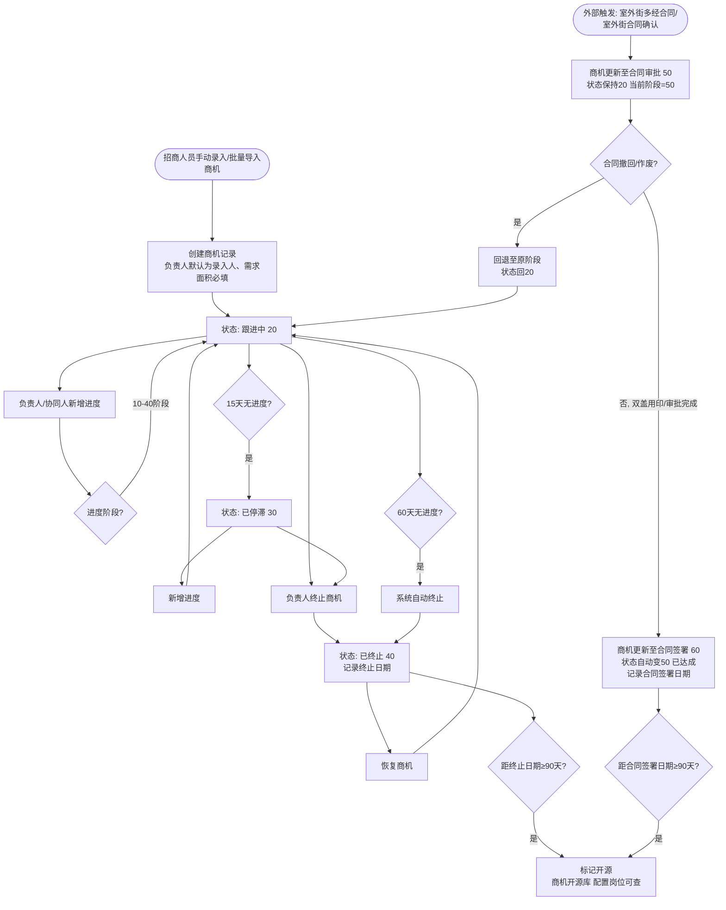

# 商机管理 — 详细需求文档

> **文档版本**：V1.3
> **修订日期**：2026-09-02
> **状态**：待评审
> **面向对象**：业务人员

## 修订记录

| 版本 | 日期 | 修订内容 | 修订人 |
|------|------|---------|--------|
| V1.0 | 2026-08-25 | 初稿 | — |
| V1.1 | 2026-08-31 | 依据需求分析确认结果整体修订，补充接口与开发计划章节，落实 Q1~Q17 确认结论 | — |
| V1.2 | 2026-08-31 | 按 V1.1 评审意见修订 33 项（页面信息移除/表结构业务化/上线计划替换等） | — |
| V1.3 | 2026-09-02 | 明确商机开源库"查看"进入只读基本信息视图（仅商机信息分节，无进度/调整记录、无操作按钮）；修正商机详情"标签页"表述为"分节" | — |

## 目录

- [1. 需求背景](#1-需求背景)
- [2. 需求概述](#2-需求概述)
- [3. 功能模块](#3-功能模块)
- [4. 表结构设计](#4-表结构设计)
- [5. 详细功能设计](#5-详细功能设计)
- [6. 后台任务](#6-后台任务)
- [7. 权限管理](#7-权限管理)
- [8. 上线计划](#8-上线计划)
- [9. 附录](#9-附录)

---

## 1. 需求背景

### 1.1 业务背景

在商业地产招商工作中，商机是品牌入驻意向的起点。招商人员需要一套完整的管理工具，能够记录从品牌接触到合同签署的全过程，跟踪每个商机的推进阶段，确保意向不遗漏、进度可追溯。

本方案聚焦于**室外街**商机管理的核心流程：招商人员手动录入或批量导入商机后，直接开始跟进，通过进度里程碑记录从初始接洽到合同签署的完整推进过程；合同审批/合同签署阶段由外部合同流程触发更新；已终止/已签约商机在满足一定时间条件后开源，面向按权限配置开放的岗位人员开放查看。

### 1.2 需求目标

| 目标类型 | 目标描述 |
|---------|---------|
| 主要目标 | 搭建室外街商机管理功能，支持手动录入/批量导入 → 跟进 → 进度 → 终止/恢复 → 达成（含外部合同流程触发 50/60 阶段）的完整闭环 |
| 次要目标 | 已终止/已签约商机按规则开源，沉淀商机资产供指定岗位复用；方案面向业务人员，清晰易懂 |

---

## 2. 需求概述

### 2.1 需求概要

搭建室外街商机管理模块，支持招商人员手动录入商机（6种来源），手动录入的商机负责人默认为录入人（当前用户），直接进入跟进状态。系统提供商机录入（含需求面积）、批量导入、列表查询、详情查看、修改、负责人更换、协同人管理、进度跟进、终止/恢复等完整功能；合同审批（50）/合同签署（60）阶段由两个外部场景触发更新（室外街多经合同、室外街合同确认），不手动新增；同时新增"商机开源库"独立菜单，已终止/已签约商机在90天后自动开源，按权限配置开放给指定岗位查看（与商机管理菜单相互独立）。系统保留必要的定时任务。

> 本模块为全新独立模块，数据对象独立建设，不依赖既有商机模块数据表，仅对齐命名风格与业务口径。

### 2.2 核心业务流程



**图2.1：室外街商机管理核心业务流程图**

流程要点：
- **50/60 阶段不手动新增**，由两个外部场景触发更新商机阶段与状态（见 R04）：
  - 场景一「室外街多经合同」：多经合同发起时须关联唯一商机并更新商机至合同审批（50）；合同撤回/作废时回退至原阶段；合同双盖用印后更新至合同签署（60）。
  - 场景二「室外街合同确认」：独立功能（具体需求后续补充），发起后更新商机至合同审批（50），审批完成后更新至合同签署（60）。
- **开源计时**：已终止商机恢复后再次终止，从新终止日期重新计时 90 天；已开源商机被恢复后再终止同样重新计时，可再次开源（见 R15）。
- **开源库访问**：商机开源库为独立菜单，按权限配置开放给指定岗位查看，非所有登录用户可见（见 R15）。

### 2.3 主要用户角色

| 角色 | 所属组织 | 主要职责 |
|------|---------|---------|
| 室外街招商人员 | 项目/区域/事业部 | 手动录入商机、批量导入商机、跟进进度、管理协同人、终止商机 |
| 商机负责人 | — | 修改商机、新增进度、管理协同人、终止商机 |
| 协同人 | — | 新增进度 |
| 项目/区域/事业部室外街招商负责人 | 项目/区域/事业部 | 负责人更换、恢复商机 |
| 开放岗位人员（按权限配置） | — | 查看"商机开源库"中的开源商机（只读） |

### 2.4 核心业务规则

| 编号 | 规则描述 | 触发条件 |
|------|---------|---------|
| R01 | 商机编号自动生成：来源字母+年月日+5位流水（如A2026071000001） | 创建商机时 |
| R02 | 手动创建的商机负责人默认为录入人（当前用户），不可修改，创建后状态=20(跟进中) | 创建商机时 |
| R03 | 仅负责人和协同人可新增进度 | 商机状态∈{20,30} |
| R04 | 50/60阶段不手动新增，由两个外部场景触发：①室外街多经合同发起时关联唯一商机→更新至合同审批(50)，合同撤回/作废时回退，双盖用印后更新至合同签署(60)；②室外街合同确认发起→合同审批(50)，审批完成→合同签署(60)；更新至合同签署(60)时商机状态自动变50(已达成) | 外部流程回调 |
| R05 | 停滞状态(30)新增进度后自动回到跟进中(20) | 状态=30且新增进度 |
| R06 | 仅负责人可终止商机，已达成(50)商机不可终止 | 状态∈{20,30} |
| R07 | 恢复权限：负责人+对应层级管理岗 | 状态=40 |
| R08 | 仅负责人可管理协同人，协同人搜索范围为整个商管事业部人员 | 任意状态 |
| R09 | 重复商机校验（仅新建与导入）：同项目下存在"跟进中(20)或已停滞(30)"且"手机号相同"的商机时，动态显示"重复理由"字段并强控必填；导入批内同项目同手机号互斥（仅首行通过）；导入校验结果以校验时点快照为准。商机修改不触发重复校验——修改联系电话不受同项目同手机号限制，不显示重复理由字段、不要求填写 | 创建/导入商机时 |
| R10 | 进度创建3天内可编辑，仅创建人可编辑，不允许修改阶段 | 编辑进度时 |
| R11 | 合同审批(50)/合同签署(60)阶段进度不可编辑 | 编辑进度时 |
| R12 | 负责人离职时，管理岗位人员可更换商机负责人；无替代人时维持原负责人（仅记录变更日志），不做其他特殊处理 | 定时任务+手动操作 |
| R13 | 商机录入/导入时"需求面积"必填，为正整数（单位：㎡） | 创建商机时 |
| R14 | 商机终止时记录"终止日期"（当前日期），系统自动终止同样记录 | 状态→40时 |
| R15 | 商机开源规则：已终止(40)商机自终止日期起满90天、已签约(50)商机自合同签署日期起满90天，由每日定时任务标记为开源；恢复后再次终止从新终止日期重新计时90天，可再次开源；开源后进入"商机开源库"，按权限配置开放给指定岗位查看（独立菜单） | 定时任务每日执行 |
| R16 | 归属组织：录入时默认取录入人权限组织（权限组织仅一个时），否则默认为空、可在权限范围内选择；归属组织类型为隐藏字段，根据归属组织自动写入；商机修改时归属组织仅限修改到下级项目。人员选择范围：负责人更换时，项目商机可选对应区域下所有人员、区域商机可选本区域下所有人员、事业部商机仅可选事业部人员 | 创建/修改/更换时 |

---

## 3. 功能模块

### 3.1 模块划分

| 模块名称 | 功能描述 | 优先级 | 依赖模块 |
|---------|---------|:------:|---------|
| 商机录入 | 手动创建商机（6种来源，负责人默认为录入人，含需求面积） | P0 | — |
| 商机导入 | 通过Excel模板批量导入商机（全量校验通过才可导入，负责人默认为导入人） | P0 | 商机录入 |
| 商机列表 | 查询、筛选商机列表 | P0 | — |
| 商机详情 | 查看商机完整信息（含进度/协同人/变更日志） | P0 | — |
| 商机修改 | 修改商机基本信息 | P0 | — |
| 负责人更换 | 批量更换商机负责人 | P0 | — |
| 协同人管理 | 管理商机协同人 | P0 | — |
| 进度管理 | 新增/编辑商机跟进进度 | P0 | — |
| 终止/恢复 | 终止或恢复商机 | P0 | — |
| 商机开源库 | 独立菜单，按权限配置开放给指定岗位的开源商机查询菜单（只读） | P0 | 后台任务-开源标记 |

> 说明：合同审批（50）/合同签署（60）阶段由外部场景（室外街多经合同、室外街合同确认）触发更新商机阶段与状态，不单独作为本模块功能点（室外街合同确认为独立功能，具体需求后续补充）。

### 3.2 模块关系

```
商机录入/商机导入 → 商机列表 → 商机详情
                ↓
    ┌───────────┼───────────┐
    ↓           ↓           ↓
  修改     协同人管理    负责人更换
                ↓
           进度管理
                ↓
           终止/恢复
                ↓
       已终止/已签约满90天自动开源
                ↓
   商机开源库（独立菜单，配置岗位可查）
```

外部触发：室外街多经合同 / 室外街合同确认 → 更新商机至合同审批（50）/合同签署（60），支持合同撤回/作废回退。

---

## 4. 表结构设计

> 本章面向业务人员，按业务视角说明本模块涉及的数据对象与关键字段；页面原型将单独输出，本 PRD 不承载页面布局信息。

### 4.1 复用现有表

| 表名 | 用途 | 关联方式 |
|------|------|---------|
| ZSTRE0002 | 品牌主表（品牌名称校验、输入联想选择后带出品牌ID） | 查询 |
| ZSTFI0000A | 用户主表（用户名-姓名映射、负责人/协同人/离职判断） | 查询 |
| ZSTFI0000E | 组织表（组织名称/层级，组织三级过滤） | 查询 |
| ZSTRE0007 | 项目表（项目信息/简称） | 查询 |
| ZSTRE0000 | 附件表（进度看场照片，存 URL） | 查询/新增/删除 |
| ZSTRE0005 | 室外街业态表（业态数据源，取 ZCLASS=1 的数据），本模块只读引用 | 查询 |
| ZSTRE0011B | 铺位表（铺位选择器数据源，取铺位类型 MTYPE=C 室外街多经、D 室外街铺位） | 查询 |
| 标准变更文档机制 | 变更日志（商机创建/修改/更换/终止/恢复/进度/导入/开源等） | 新增 |
| 组织树服务 | 归属组织选择、组织数据权限过滤 | 调用 |
| 小新消息组件 | 消息卡片推送（负责人更换/离职更换/恢复/自动终止/每周提醒），复用现有发送组件与接收人逻辑 | 调用 |

### 4.2 新增业务数据表

#### 商机主表

| 字段（业务逻辑名称） | 必填 | 默认值 | 取值范围 | 说明 |
|----------------------|:----:|--------|----------|------|
| 商机编号 | 是 | — | 唯一 | 来源字母+年月日+5位流水（如 A2026071000001） |
| 商机来源 | 是 | — | A/B/C/D/E/F | 6种来源 |
| 品牌名称 | 否 | — | — | 手填，输入关键字联想选择品牌库品牌 |
| 品牌ID | 否 | — | — | 选择品牌库品牌时带出 |
| 业态 | 是 | — | 室外街业态表（ZSTRE0005，ZCLASS=1） | 只读引用，枚举值以该表为准 |
| 需求面积 | 是 | — | 正整数 | 单位㎡ |
| 经营模式 | 是 | — | 直营/代理商 | — |
| 需求概述 | 否 | — | ≤255字符 | 意向租期等 |
| 联系人姓名 | 是 | — | — | — |
| 联系人职务 | 否 | — | — | — |
| 联系电话 | 是 | — | 11位手机号 | 重复校验依据 |
| 重复理由 | 条件 | — | — | 新建/导入命中重复校验时必填（修改不校验） |
| 录入人 | 是 | 当前用户 | — | 商机创建人 |
| 负责人 | 是 | 录入人（当前用户） | — | 录入时默认为录入人，不可修改 |
| 商机状态 | 是 | 跟进中 | 跟进中/已停滞/已终止/已达成 | 系统维护 |
| 当前阶段 | 否 | — | 10~60 | 取最新进度阶段；50/60 由外部触发更新 |
| 终止原因 | 条件 | — | — | 终止时必填 |
| 终止日期 | 条件 | — | — | 终止时自动记录当前日期；恢复时清空 |
| 合同签署日期 | 条件 | — | — | 更新至合同签署（60）时冗余写入 |
| 是否开源 | 是 | 否 | 是/否 | 每日任务维护；恢复时清空 |
| 开源日期 | 否 | — | — | 标记开源时记录；恢复时清空 |
| 归属组织类型 | 是 | 隐藏字段 | 项目/区域/事业部 | 根据归属组织自动写入，不显示 |
| 归属组织 | 是 | 录入人权限组织（仅一个时） | — | 多个权限组织时默认为空、可在权限范围内选择；修改时仅限下级项目 |
| 最新进度日期 | 否 | — | — | 新增/编辑进度时更新；停滞/自动终止/每周提醒计时基准 |

#### 商机进度表

| 字段（业务逻辑名称） | 必填 | 默认值 | 取值范围 | 说明 |
|----------------------|:----:|--------|----------|------|
| 关联商机 | 是 | — | — | 所属商机 |
| 阶段 | 是 | — | 10~60 | 10~40手动新增；60外部回调落一条；50不落进度行 |
| 进度内容 | 条件 | — | ≤255字符 | 10~40必填 |
| 租金 | 条件 | — | ≥0 | 30/40必填 |
| 管理费 | 条件 | — | ≥0 | 30/40必填 |
| 免租期（月） | 条件 | — | 正整数 | 30/40必填 |
| 意向金 | 条件 | — | 是/否 | 40必输 |
| 看场照片 | 条件 | — | jpg/png，单张≤5MB，最多9张 | 20必填；存附件表 URL |
| 创建人 | 是 | 当前用户 | — | 编辑权限3天+创建人限定 |
| 创建时间 | 是 | 当前时间 | — | 开源计时/编辑窗口/停滞计时基准 |

#### 商机协同人表

| 字段（业务逻辑名称） | 必填 | 默认值 | 取值范围 | 说明 |
|----------------------|:----:|--------|----------|------|
| 关联商机 | 是 | — | — | — |
| 协同人账号 | 是 | — | — | 搜索范围为整个商管事业部人员 |
| 协同人角色 | 否 | 普通协同人 | — | 本版本固定为普通协同人 |
| 有效标记 | 是 | 有效 | 有效/无效 | 软删除 |

#### 铺位关联表

| 字段（业务逻辑名称） | 必填 | 默认值 | 取值范围 | 说明 |
|----------------------|:----:|--------|----------|------|
| 关联进度 | 是 | — | — | 一条进度可关联多条铺位 |
| 铺位编号 | 是 | — | — | — |
| 铺位唯一标识 | 是 | — | — | 来自铺位表（ZSTRE0011B） |
| 铺位类型 | 是 | — | 室外街多经/室外街铺位 | 即铺位表 MTYPE 为 C/D |
| 所属项目 | 是 | — | — | — |

#### 阶段配置表

| 字段（业务逻辑名称） | 必填 | 默认值 | 取值范围 | 说明 |
|----------------------|:----:|--------|----------|------|
| 阶段编码 | 是 | — | 10~60 | — |
| 阶段名称 | 是 | — | — | 10初始接洽/20邀约看场/30品牌回价/40意向确认/50合同审批/60合同签署 |

> 各阶段必填项规则（铺位/内容/看场照片/租金/管理费/免租期/意向金）本版本按功能设计固化（见 §5.7.1），不配置化。

#### 来源配置表

| 字段（业务逻辑名称） | 必填 | 默认值 | 取值范围 | 说明 |
|----------------------|:----:|--------|----------|------|
| 来源编码 | 是 | — | A/B/C/D/E/F | — |
| 来源名称 | 是 | — | — | A商家主动咨询/B内外部推荐/C公司品牌库/D电话拓展/E扫街拓展/F网络信息 |

#### 流水号表

| 字段（业务逻辑名称） | 必填 | 默认值 | 取值范围 | 说明 |
|----------------------|:----:|--------|----------|------|
| 日期 | 是 | — | — | 按日期分组 |
| 当日流水号 | 是 | 00001 | 00001~99999 | 生成时排他锁，最多重试5次 |

#### 导入记录表

| 字段（业务逻辑名称） | 必填 | 默认值 | 取值范围 | 说明 |
|----------------------|:----:|--------|----------|------|
| 批次号 | 是 | — | 唯一 | — |
| 导入人 | 是 | 当前用户 | — | — |
| 导入时间 | 是 | 当前时间 | — | — |
| 总行数 | 是 | 0 | ≥0 | — |
| 成功行数 | 是 | 0 | ≥0 | — |
| 失败行数 | 是 | 0 | ≥0 | — |

> 导入采用"全量校验通过才可导入"模式，错误明细不入库（无错误明细字段），校验失败时界面按行展示本次校验结果供修正。

### 4.3 变更日志

商机创建、修改、负责人更换、终止、恢复、进度更新、导入、开源、外部阶段更新等关键操作均需记录变更日志，使用系统标准变更文档机制。前台页面可显示每次修改的变化记录。

---

## 5. 详细功能设计

### 5.1 商机录入

#### 5.1.1 功能点：新增商机

**功能描述**：招商人员手动创建一条新商机记录，负责人默认为录入人（当前用户）。

**字段清单**：

| 字段名 | 数据来源 | 是否可编辑 | 默认值 | 必填 | 校验规则 |
|--------|---------|:---------:|--------|:----:|---------|
| 归属组织类型 | 自动 | 隐藏 | — | ✅ | 根据归属组织自动写入（项目/区域/事业部），不显示 |
| 归属组织 | 组织选择器 | 可编辑 | 录入人权限组织（仅一个时）；多个时为空 | ✅ | 在权限范围内选择 |
| 商机来源 | 配置表 | 可选 | — | ✅ | A/B/C/D/E/F |
| 品牌名称 | 手填（联想选择） | 可编辑 | — | | 输入关键字联想展示含关键字的品牌，选择后带出品牌ID |
| 品牌ID | 品牌库 | 自动带出 | — | | 选择品牌库品牌时有值 |
| 业态 | 室外街业态表 | 可选 | — | ✅ | ZSTRE0005 中 ZCLASS=1 的业态（枚举值以该表为准） |
| 需求面积 | 手填 | 可编辑 | — | ✅ | 正整数，单位㎡ |
| 经营模式 | 枚举 | 可选 | — | ✅ | 直营/代理商 |
| 需求概述 | 手填 | 可编辑 | — | | ≤255字符 |
| 联系人姓名 | 手填 | 可编辑 | — | ✅ | 必填 |
| 联系人职务 | 手填 | 可编辑 | — | | |
| 联系电话 | 手填 | 可编辑 | — | ✅ | 11位手机号，必填 |
| 重复理由 | 手填 | 可编辑 | 隐藏 | 条件必填 | 命中重复校验时动态显示并必填 |
| 负责人 | — | 不可编辑 | 录入人（当前用户） | ✅ | 默认为录入人，不可修改 |

**交互逻辑**：

| 操作 | 触发条件 | 系统行为 | 后置状态 |
|------|---------|---------|---------|
| 选择归属组织 | 归属组织字段 | 默认取录入人权限组织（仅一个时），多个权限组织时默认为空、在权限范围内选择；归属组织类型自动写入 | 负责人默认为录入人，无需选择 |
| 输入品牌名称 | 品牌字段输入关键字 | 联想展示含关键字的品牌，选择后自动带出品牌名称、品牌ID | 业态与品牌独立选择 |
| 录入联系电话 | 联系电话失焦/保存时 | 实时校验同项目下是否存在"跟进中/已停滞"且同手机号的商机 | 命中则动态显示"重复理由"字段 |
| 点击保存 | 所有必填项已填 | 校验数据→生成商机编号→状态=20(跟进中)→保存→记录日志 | 跳转列表或详情 |

**业态选择说明**：

- 业态为**下拉选择**，数据来源为已有"室外街业态表"（表 ZSTRE0005），取 **ZCLASS=1** 的数据，本模块只读引用，不新建业态枚举配置表
- 品牌与业态独立选择，选择品牌库品牌**不自动带出业态**

**字段级校验规则**：

| 字段 | 校验规则 | 错误提示 |
|------|---------|---------|
| 归属组织 | 必填且为权限范围内的组织 | 请选择归属组织 |
| 商机来源 | 必填且为A/B/C/D/E/F | 请选择商机来源 |
| 业态 | 必填且为室外街业态表（ZCLASS=1）枚举值之一 | 请选择业态 |
| 需求面积 | 必填且为正整数 | 请输入正确的需求面积（正整数，单位㎡） |
| 经营模式 | 必填且为直营或代理商 | 请选择经营模式 |
| 联系电话 | 必填，11位手机号 | 请输入正确的手机号 |
| 重复理由 | 命中重复校验时必填 | 请填写重复理由 |
| 品牌ID | 选择品牌库时校验品牌存在 | 品牌不存在，请重新选择 |

**重复商机校验**：

| 校验场景 | 校验范围 | 系统行为 |
|---------|---------|---------|
| 相同手机号 | 同项目下，存在状态∈{跟进中20, 已停滞30}且联系电话相同的商机 | 动态显示"重复理由"字段并强控必填；填写重复理由后方可保存 |

> 说明：已终止(40)/已达成(50)商机不参与重复校验；重复校验仅在新建商机与批量导入时执行，修改商机（含修改联系电话）不触发重复校验、不显示重复理由字段（见 §5.4）。

**异常处理**：

| 异常场景 | 系统行为 |
|---------|---------|
| 流水号生成失败（锁表） | 最多重试5次，每次间隔1秒，最终失败则提示"系统繁忙，请稍后重试" |
| 当日流水号达99999上限 | 提示"今日商机创建已达上限，请明日再试" |

---

### 5.2 商机列表

#### 5.2.1 功能点：商机列表查询

**功能描述**：招商人员查看和管理自己权限范围内的商机列表。

**查询条件**：

| 条件字段 | 匹配方式 | 是否必填 | 默认值 | 说明 |
|---------|---------|:-------:|--------|------|
| 商机来源 | 精确（多选） | 否 | — | A/B/C/D/E/F |
| 品牌名称 | 模糊 | 否 | — | |
| 业态 | 精确（多选） | 否 | — | 室外街业态表多选 |
| 负责人 | 模糊 | 否 | — | |
| 商机状态 | 精确（多选） | 否 | 默认20/30 | 跟进中/已停滞 |
| 跟进阶段 | 精确（多选） | 否 | — | 10~60 |
| 联系电话 | 模糊 | 否 | — | |
| 需求面积 | 区间 | 否 | — | 支持最小/最大值 |

**列表字段**：

| 列名 | 数据来源 | 说明 |
|------|---------|------|
| 选择框 | — | 多选，用于批量操作 |
| 所属组织 | 商机主表+组织表 | 显示项目/区域/事业部名称 |
| 商机来源 | 商机主表+来源配置 | 显示来源名称 |
| 品牌 | 商机主表 | 品牌名称 |
| 业态 | 商机主表+室外街业态表 | 显示业态名称 |
| 需求面积 | 商机主表 | 显示需求面积(㎡) |
| 联系人 | 商机主表 | 联系人姓名 |
| 职务 | 商机主表 | |
| 负责人 | 商机主表+用户表 | 负责人姓名 |
| 商机状态 | 商机主表 | 跟进中/已停滞/已终止/已达成 |
| 跟进阶段 | 商机主表（取最新进度阶段） | 无进度则为空 |

> 说明：列表不展示商机编号，跳转商机详情通过"查看"按钮。

**操作按钮显示规则**：

| 按钮 | 显示条件 | 操作对象 |
|------|---------|---------|
| 新增 | 始终显示 | — |
| 导入 | 有商机录入权限时显示 | — |
| 查看 | 选中单条 | 选中商机（跳转详情） |
| 修改 | 选中单条且可编辑 | 选中商机 |
| 新增进度 | 选中单条且当前用户是负责人/协同人且状态∈{20,30} | 选中商机 |
| 负责人更换 | 选中多条且有权限 | 选中商机 |
| 协同人管理 | 选中单条且当前用户是负责人 | 选中商机 |
| 终止 | 选中单条且状态∈{20,30}且当前用户是负责人 | 选中商机 |
| 恢复 | 选中单条且状态=40且有恢复权限 | 选中商机 |

**排序规则**：
- 先按**当前阶段倒序**，再按**更新日期倒序**，最后按**商机编号倒序**

---

### 5.3 商机详情

#### 5.3.1 功能点：查看商机详情

**功能描述**：查看商机的完整信息，包括基本信息、进度列表、变更日志。

**详情页操作按钮权限**：

| 按钮 | 显示条件 |
|------|---------|
| 修改 | 可编辑标记=是 |
| 协同人管理 | 当前用户是负责人 |
| 终止 | 状态∈{20,30}且当前用户是负责人 |
| 恢复 | 状态=40且当前用户有恢复权限 |

**分节内容**：

| 分节 | 显示内容 |
|------|---------|
| 商机信息 | 商机所有字段信息（含需求面积、终止日期、合同签署日期、开源标记），**协同人以合并字段（协同人姓名列表）直接展示在基本信息中，不设独立标签页** |
| 商机进度 | 进度列表（按时间倒序），每条显示阶段/内容/铺位/租金/管理费/免租期/意向金/创建人/创建时间，支持新增进度 |
| 商机信息调整记录 | 变更记录列表，**默认折叠隐藏，点击展开查看** |

> 商机状态为"已终止"时，商机信息分节展示"终止日期"；已开源商机展示"是否开源"标记；状态为"已达成(50)"的商机展示"合同签署日期"。

> **视图说明**：商机详情支持两种视图——①**完整视图**（默认，含商机信息/商机进度/商机信息调整记录三分节与操作按钮）；②**只读基本信息视图**（商机开源库"查看"进入，仅展示商机信息分节、无操作按钮，见 §5.10）。

---

### 5.4 商机修改

#### 5.4.1 功能点：修改商机

**功能描述**：商机负责人修改商机基本信息。

**可修改字段**：

| 字段 | 是否可修改 | 说明 |
|------|:---------:|------|
| 品牌 | ✅ | |
| 业态 | ✅ | 室外街业态表 |
| 需求面积 | ✅ | 正整数校验 |
| 经营模式 | ✅* | 为空时可修改，有值时不可修改 |
| 联系人 | ✅ | |
| 职务 | ✅ | |
| 联系电话 | ✅ | 11 位手机号；修改后不触发重复校验（不显示/不要求重复理由） |
| 需求概述 | ✅ | |
| 归属组织 | ✅ | 仅限修改到下级项目 |

**业务规则**：
- 修改权限：仅商机负责人
- 修改后记录变更日志（对比新旧数据）
- 品牌名称为空但品牌ID有值时，自动从品牌表带出品牌名
- 修改商机不执行重复商机校验：修改联系电话不受"同项目+跟进中/已停滞+同手机号"限制，不显示重复理由字段、不要求填写即可保存；重复校验仅在新建与导入时执行（见 R09）
- 修改归属组织时，**仅限修改到下级项目**（见 R16）

**异常处理**：

| 异常场景 | 系统行为 |
|---------|---------|
| 当前用户非负责人 | 提示"您不是商机负责人，无法修改" |
| 商机状态=50(已达成) | 提示"已达成商机不可修改" |
| 修改归属组织超出下级项目范围 | 提示"仅可修改到下级项目" |

---

### 5.5 负责人更换

#### 5.5.1 功能点：批量更换负责人

**功能描述**：管理岗人员批量更换商机负责人（适用于负责人离职场景）。

**权限规则**：

| 操作人角色 | 可操作范围 |
|-----------|-----------|
| 项目室外街招商负责人 | 归属组织为对应项目的所有商机 |
| 区域室外街招商负责人 | 归属组织为对应区域的所有商机 |
| 事业部室外街招商负责人 | 归属组织为对应事业部的所有商机 |

**人员选择范围**（R16）：

| 商机归属组织 | 可选人员范围 |
|------------|------------|
| 项目 | 对应区域下所有人员 |
| 区域 | 本区域下所有人员 |
| 事业部 | 仅事业部人员 |

**交互逻辑**：

| 步骤 | 操作 | 系统行为 |
|------|------|---------|
| 1 | 列表多选商机 | 校验有权限 |
| 2 | 点击"负责人更换" | 弹窗选择一个新的新人员（范围见上表） |
| 3 | 确认更换 | 更新负责人、记录日志、发送小新提醒 |

**消息提醒**：
- 给更换后的新负责人发送小新消息
- 按人员汇总：一个用户一次被更换为多条商机负责人，发送一条提醒
- 消息卡片：
  - 标题：商机负责人更换提醒
  - 内容：品牌：XXX、XXX、XXX，以上品牌的商机负责人已更换为您，请及时关注并跟进！
  - 查看：跳转商机详情

---

### 5.6 协同人管理

#### 5.6.1 功能点：管理协同人

**功能描述**：商机负责人管理商机的协同人，支持多选人员。

**业务规则**：
- 权限：仅商机负责人可操作
- 支持多选人员，**协同人搜索范围为整个商管事业部人员**（R08/R16）
- 保存时更新协同人列表（新增/软删除）
- 记录添加/删除变更日志
- 协同人仅属室外街商机管理逻辑（商机开源库为独立菜单，与协同人无关）

**异常处理**：

| 异常场景 | 系统行为 |
|---------|---------|
| 当前用户非负责人 | 提示"仅商机负责人可管理协同人" |

---

### 5.7 进度管理

#### 5.7.1 功能点：新增进度

**功能描述**：商机负责人或协同人新增一条跟进进度。

**阶段必填项规则**：

| 阶段 | 铺位 | 内容 | 看场照片 | 租金 | 管理费 | 免租期（月） | 意向金 |
|:----:|:----:|:----:|:-------:|:---:|:-----:|:-----------:|:-----:|
| 10 初始接洽 | 可选 | 必填 | — | — | — | — | — |
| 20 邀约看场 | 必填 | 必填 | 必填 | — | — | — | — |
| 30 品牌回价 | 必填 | 必填 | — | 必填 | 必填 | 必填 | — |
| 40 意向确认 | 必填 | 必填 | — | 必填 | 必填 | 必填 | 必输(是/否) |
| 50 合同审批 | — | — | — | — | — | — | — |
| 60 合同签署 | — | — | — | — | — | — | — |

> 注：**50/60阶段不手动新增**，由两个外部场景触发更新商机阶段与状态（见 R04）——①室外街多经合同发起时关联唯一商机→更新至合同审批(50)，合同撤回/作废时回退，双盖用印后更新至合同签署(60)；②室外街合同确认发起→合同审批(50)，审批完成→合同签署(60)。更新至合同签署(60)时在进度表落一条阶段=60的进度记录。

**业务规则**：
- 权限：仅负责人和协同人可新增
- 状态∈{20,30}可新增；{40,50}不可新增
- 当前阶段=50或60不可新增
- 更新至合同签署(60)时，商机状态自动变为50(已达成)，并冗余写入"合同签署日期"（当前日期，供开源计时与详情展示使用，见 R15）
- 状态=30(停滞)新增进度后，自动回到20(跟进中)
- 新增/编辑进度时同步更新主表"最新进度日期"（供停滞/自动终止/每周提醒计时）
- 阶段切换时自动带出历史数据：
  - 阶段40：从最近阶段30或40进度带出**租金/管理费/免租期/铺位**
  - 阶段20/30：从历史进度带出铺位
- 铺位选择器按商机归属组织过滤可选铺位范围，可选"室外街多经"与"室外街铺位"，即表 ZSTRE0011B 中铺位类型（MTYPE）为 C 和 D 的铺位
- 看场照片：复用附件表 ZSTRE0000（存 URL），**支持 jpg/png 格式、单张不超过 5MB、每条进度最多 9 张**

**异常处理**：

| 异常场景 | 系统行为 |
|---------|---------|
| 当前用户非负责人/协同人 | 提示"您不是商机负责人或协同人，不能更新商机进度" |
| 商机状态=40/50 | 提示"当前商机状态不允许新增进度" |
| 当前阶段=50/60 | 提示"合同审批/签署阶段不允许新增进度" |

#### 5.7.2 功能点：编辑进度

**功能描述**：进度创建人编辑自己创建的进度。

**业务规则**：
- 编辑权限：仅进度创建人
- 时间限制：进度创建3天内可编辑
- 阶段限制：合同审批(50)/合同签署(60)进度不可编辑
- **不允许修改阶段**（阶段一经创建不可变更）
- 可编辑字段：阶段之外的其他字段均可修改

**异常处理**：

| 异常场景 | 系统行为 |
|---------|---------|
| 超过3天 | 隐藏编辑按钮/拒绝编辑 |
| 非创建人 | 隐藏编辑按钮/拒绝编辑 |
| 阶段=50/60 | 隐藏编辑按钮/拒绝编辑 |
| 尝试修改阶段 | 拒绝，提示"进度阶段不可修改" |

---

### 5.8 商机终止/恢复

#### 5.8.1 功能点：终止商机

**功能描述**：商机负责人终止跟进中的商机。

**交互逻辑**：

| 步骤 | 操作 | 系统行为 |
|------|------|---------|
| 1 | 列表选中单条商机 | 校验状态∈{20,30} |
| 2 | 点击"终止"按钮 | 校验当前用户是负责人 |
| 3 | 弹窗输入终止原因 | 终止原因必填 |
| 4 | 确认终止 | 更新状态→40、记录终止原因、记录终止日期（当前日期）、记录日志 |

**业务规则**：
- 权限：仅商机负责人
- 状态∈{20,30}可终止；**状态=50(已达成)不可终止**（显式禁止）
- 终止后状态变为40(已终止)
- 必填终止原因
- 记录终止日期：状态→40时自动写入当前日期（系统自动终止同样记录）
- 记录变更日志
- **负责人手动终止不发送小新消息**（系统自动终止仍发送提醒，见 §6.3）

**消息卡片**：
- 负责人手动终止不发送消息（无消息卡片）

#### 5.8.2 功能点：恢复商机

**功能描述**：有权限的人员恢复已终止的商机。

**权限规则**：

| 商机归属组织 | 可恢复人员 |
|------------|-----------|
| 项目 | 负责人 + 项目室外街招商负责人 |
| 区域 | 负责人 + 区域室外街招商负责人 |
| 事业部 | 负责人 + 事业部室外街招商负责人 |

**交互逻辑**：

| 步骤 | 操作 | 系统行为 |
|------|------|---------|
| 1 | 列表选中单条状态=40的商机 | 校验有恢复权限 |
| 2 | 点击"恢复"按钮 | 弹窗二次确认 |
| 3 | 确认恢复 | 更新状态→20、清空终止原因、清空终止日期、清除开源标记（若已开源）、记录日志 |

**业务规则**：
- 状态=40(已终止)可恢复
- 恢复后状态变为20(跟进中)
- 清空终止原因、终止日期；若该商机已被标记开源，恢复时同步清除开源标记（不再出现在开源库）
- **开源计时重置**：恢复后再次终止，从新的终止日期重新计时 90 天，可再次开源；已开源商机被恢复后再终止同样重新计时，可再次开源（R15）
- 记录变更日志
- **消息发送**：负责人自行恢复不发送消息；**管理岗代为恢复时发送恢复提醒给负责人**（标题：商机恢复提醒；内容：您负责的商机已恢复，请及时跟进；查看：跳转商机详情）

---

### 5.9 商机导入

#### 5.9.1 功能点：批量导入商机

**功能描述**：支持通过Excel模板批量导入商机，适用于电话拓展、扫街拓展等大批量商机场景。导入采用"全量校验通过才可导入"模式。

**导入模板字段**（与商机录入字段对齐，不含负责人列，含"重复理由"列）：

| 模板列 | 必填 | 校验规则 |
|--------|:----:|---------|
| 归属组织 | ✅ | **组织名称，必须完全匹配**，且有效 |
| 商机来源 | ✅ | A/B/C/D/E/F 或来源名称 |
| 品牌名称 | | **手填**（品牌名称直接手填） |
| 业态 | ✅ | 室外街业态表（ZCLASS=1）枚举值 |
| 需求面积 | ✅ | 正整数，单位㎡ |
| 经营模式 | ✅ | 直营/代理商 |
| 需求概述 | | ≤255字符 |
| 联系人姓名 | ✅ | 必填 |
| 联系人职务 | | |
| 联系电话 | ✅ | 11位手机号 |
| 重复理由 | 条件必填 | 命中重复校验时必填 |

> 导入模板**不设"负责人"列，导入商机的负责人默认为导入人（当前用户）**。

**处理逻辑**（同步两步：上传→校验→确认后同步入库）：

| 步骤 | 说明 |
|------|------|
| 1 | 下载标准导入模板（含字段说明与示例行，含"重复理由"列，无"负责人"列） |
| 2 | 上传文件，系统校验文件格式（.xlsx）、行数（≤1000行） |
| 3 | 逐行校验字段：必填、格式、来源枚举、业态枚举、手机号、需求面积、归属组织名称完全匹配 |
| 4 | 逐行执行重复校验（同项目+跟进中/已停滞+同手机号），命中且未填"重复理由"的行校验不通过；**批内同项目同手机号互斥，仅首行通过** |
| 5 | 校验完成后展示通过/不通过数量，不通过行在界面按行展示原因（错误明细不入库） |
| 6 | **全量校验通过才可导入**：所有行校验通过才执行导入，任一失败则整体不导入、提示修正后重新导入；确认后同步入库，每行独立生成商机编号、负责人=导入人、状态=20(跟进中)、记录变更日志 |

**业务规则**：
- 权限：有商机录入权限的人员（室外街招商人员及各层级招商负责人）可导入
- 校验结果以**校验时点快照为准**：校验通过到确认入库期间即使他人新建同手机号商机，入库沿用校验时点结果（R09）
- 导入成功后系统记录导入记录（批次、导入人、导入时间、总行数、成功/失败数量，无错误明细字段）
- 导入商机编号规则、状态规则与手动录入一致（见 §9.1、§9.2）
- 单次导入上限1000行，超出提示"单次最多导入1000条"

**异常处理**：

| 异常场景 | 系统行为 |
|---------|---------|
| 文件格式不正确 | 提示"请上传.xlsx格式文件" |
| 文件超过1000行 | 提示"单次最多导入1000条" |
| 存在校验不通过的行 | **整体不导入**，界面按行展示原因，提示修正后重新导入（不生成部分成功数据） |
| 确认导入时系统异常 | 事务回滚，提示导入失败，重新导入 |

---

### 5.10 商机开源库

#### 5.10.1 功能点：商机开源库查询

**功能描述**：按权限配置开放给指定岗位的商机查询菜单（独立菜单）。已终止/已签约商机在满足开源条件后，开放岗位人员可查看。

**开源规则**（规则R15）：

| 商机状态 | 开源计时起点 | 开源条件 |
|---------|------------|---------|
| 40 已终止 | 终止日期 | 距终止日期≥90天 |
| 50 已签约（已达成） | 合同签署日期 | 距合同签署日期≥90天 |

- 开源由**每日定时任务**统一标记（见 §6.5），标记后商机"是否开源=是"，并记录"开源日期"
- 开源后商机进入"商机开源库"，**按权限配置开放给指定岗位查看**（独立菜单，与室外街商机管理相互独立，访问通过独立岗位/角色权限配置控制，功能本身无特殊控制）
- 开源不改变商机状态与归属组织，仅开放查看权限；**数据形态为主表冗余"是否开源/开源日期"**，开源库查询直接过滤主表"是否开源=是"，在接口层放开组织数据权限
- **开源计时重置**：已开源商机被恢复后，清除开源标记；恢复后再次终止，从新终止日期重新计时 90 天，可再次开源（R15）

**查询条件**：

| 条件字段 | 匹配方式 | 说明 |
|---------|---------|------|
| 商机编号 | 模糊 | |
| 商机来源 | 精确（多选） | A/B/C/D/E/F |
| 品牌名称 | 模糊 | |
| 业态 | 精确（多选） | 室外街业态表 |
| 商机状态 | 精确（多选） | 仅40/50 |
| 联系电话 | 模糊 | |
| 需求面积 | 区间 | 支持最小/最大值 |
| 开源日期 | 区间 | |
| 所属组织 | 精确 | 可选 |

**列表字段**：所属组织、商机来源、品牌、业态、需求面积、联系人、**联系人职务**、负责人、商机状态、开源日期

> 说明：开源库列表不展示商机编号、联系电话、终止日期/合同签署日期；操作按钮仅提供"**查看**"——点击跳转商机详情的**只读基本信息视图**（见下方"操作限制"）。

**业务规则**：
- **查看权限**：**按权限配置开放给指定岗位**（独立岗位/角色权限配置，单独设置开放岗位），非所有登录用户默认可见；不受组织数据权限限制（接口层放开）
- **操作限制**：开源库仅支持查看，不提供修改、终止、恢复、进度新增等操作；"查看"进入商机详情的**只读基本信息视图**：仅展示"商机信息"分节（含需求面积、终止日期、合同签署日期、开源标记、协同人合并字段），**不展示"商机进度""商机信息调整记录"分节**，**不显示修改/协同人管理/终止/恢复等操作按钮**，全部字段只读
- 数据来源：商机主表"是否开源=是"的商机（无独立开源库表）

---

## 6. 后台任务

### 6.1 任务清单

| 任务名称 | 执行频率 | 优先级 | 说明 |
|---------|---------|:------:|------|
| 负责人离职自动更换 | 每日9:20 | P0 | 处理离职人员名下商机 |
| 商机状态自动更新 | 每日8:00 | P0 | 停滞/自动终止 |
| 进度更新提醒 | 每周一10:00 | P1 | 7天无进度提醒 |
| 商机开源标记更新 | 每日3:00 | P0 | 满足条件的已终止/已签约商机标记开源 |

### 6.2 任务：负责人离职自动更换

- **执行频率**：每日9:20
- **核心逻辑**：
  1. 查询状态∈{20,30}的商机
  2. 判断负责人是否已离职（负责人在平台已无有效账号）
  3. 自动更换负责人：
     - 归属项目：→项目室外街招商负责人（无则项目对接管理岗）
     - 归属区域：→区域室外街招商负责人
     - 归属事业部：→事业部室外街招商负责人
  4. **无替代人时维持原负责人**，仅记录变更日志，不做其他特殊处理（R12）
  5. 记录变更日志
  6. 按人员汇总发送小新提醒
- **日志要求**：记录任务执行批次、处理商机数、更换成功数、无替代人数（异常标记）
- **异常处理**：单条商机处理异常不影响后续；任务级异常记录至任务日志并告警

**消息卡片**：
- 标题：商机负责人更换提醒
- 内容：品牌：XXX、XXX、XXX，以上品牌的商机负责人已更换为您，请及时关注并跟进！
- 查看：跳转商机详情

### 6.3 任务：商机状态自动更新

- **执行频率**：每日8:00
- **核心逻辑**：
  1. 查询状态∈{20,30}的商机
  2. 跟进中(20)状态：15天无进度更新 → 状态变为30(已停滞)
  3. 跟进中/已停滞(20/30)状态：60天无进度更新 → 状态变为40(已终止)，终止原因="60天无进度更新，系统自动终止"，记录终止日期（当前日期）
  4. 无进度判断依据主表"最新进度日期"（新增/编辑进度时更新）
  5. 记录变更日志
  6. 发送小新提醒（仅自动终止场景）
- **日志要求**：记录处理商机数、状态变更明细
- **异常处理**：单条处理异常跳过并记录，不影响后续；任务级异常记录至任务日志

**消息卡片（自动终止）**：
- 标题：商机终止提醒
- 内容：品牌、业态、联系人、您负责的商机60天无进度更新，已自动终止，请知晓！

> 说明：商机停滞（15天无进度→已停滞）状态变更时不发送消息。

### 6.4 任务：进度更新提醒

- **执行频率**：每周一10:00
- **核心逻辑**：
  1. 查询状态∈{20,30}且7天无进度更新的所有商机（依据最新进度日期）
  2. 以用户为单位汇总
  3. 每个用户发送一条提醒消息（每个用户每周最多收到一条）
- **日志要求**：记录汇总用户数、发送条数
- **异常处理**：发送失败重试，最终失败记录日志

**消息卡片**：
- 标题：商机更新提醒
- 内容：您有X个负责的商机7天无进度更新，请及时关注并跟进！
- 查看：跳转商机列表

### 6.5 任务：商机开源标记更新

- **执行频率**：每日3:00
- **核心逻辑**：
  1. 查询"是否开源=否"的商机
  2. 已终止(40)商机：终止日期距今≥90天
  3. 已签约(50)商机：合同签署日期距今≥90天
  4. 满足条件的商机标记"是否开源=是"，记录"开源日期"（当前日期），记录变更日志
- **幂等性**：仅处理未开源商机，已开源商机不重复处理
- **日志要求**：记录标记开源商机数
- **异常处理**：单条处理异常跳过并记录，不影响后续

---

## 7. 权限管理

### 7.1 角色权限矩阵

| 角色 | 录入 | 导入 | 列表查看 | 修改 | 负责人更换 | 协同人管理 | 进度新增 | 终止 | 恢复 | 开源库查看 |
|------|:----:|:----:|:-------:|:---:|:---------:|:---------:|:-------:|:---:|:---:|:-------:|
| 室外街招商人员 | ✅ | ✅ | 权限范围 | 自己负责的 | ❌ | 自己负责的 | 自己负责/协同的 | 自己负责的 | 自己负责的 | 配置岗位可查 |
| 项目室外街招商负责人 | ✅ | ✅ | 本项目 | 自己负责的 | ✅ | 自己负责的 | 自己负责/协同的 | 自己负责的 | 本项目 | 配置岗位可查 |
| 区域室外街招商负责人 | ✅ | ✅ | 本区域 | 自己负责的 | ✅ | 自己负责的 | 自己负责/协同的 | 自己负责的 | 本区域 | 配置岗位可查 |
| 事业部室外街招商负责人 | ✅ | ✅ | 全部 | 自己负责的 | ✅ | 自己负责的 | 自己负责/协同的 | 自己负责的 | 事业部 | 配置岗位可查 |
| 其他人员 | ❌ | ❌ | ❌ | ❌ | ❌ | ❌ | ❌ | ❌ | ❌ | 配置岗位可查 |

> **开源库查看**：室外街商机管理与商机开源库为**两个独立菜单、相互独立**；商机开源库访问通过**独立岗位/角色权限配置控制**（单独设置开放岗位），功能本身无特殊控制——非所有登录用户默认可见。

### 7.2 数据权限（组织三级过滤）

| 用户层级 | 数据范围 | 说明 |
|---------|---------|------|
| 项目 | 当前项目 | 仅看归属组织为本项目的商机 |
| 区域 | 当前区域及下属项目 | 看归属组织为本区域及区域下所有项目的商机 |
| 事业部 | 事业部范围 | 看所有商机 |

**取数逻辑**：
- 【账号在对应组织及下属组织中负责人等于自己的商机】
- 【或：协同人包含自己的所有商机】（协同人身份即商机可见与进度新增权限来源，属室外街商机管理逻辑）
- 【或：账号在对应组织及下属组织中有管理岗的组织下所有商机】

> 注：取账号作为协同人的商机数据时没有商机归属组织的判断，会出现某个用户在组织A下看到组织B的商机的情况。

> **例外说明**："商机开源库"的查看**不受上述组织三级过滤限制**（接口层放开组织权限），但**菜单访问由独立岗位/角色权限配置控制**，仅配置岗位可查。

---

## 8. 上线计划

| 节点 | 完成日期 |
|------|---------|
| 开发交付 | 2026-10-15 |
| 测试完成 | 2026-10-31 |
| 上线 | 2026-11-10 |

---

## 9. 附录

### 9.1 商机编号规则

```
商机编号 = SRC + YYYYMMDD + NNNNN（5位流水）

示例：A2026071000001

说明：
- SRC：商机来源字母（A/B/C/D/E/F）
- YYYYMMDD：创建日期
- NNNNN：当日流水号（00001~99999，5位）

流水号按日期分组，每日从00001开始，通过流水号表管理，生成时使用排他锁防止并发冲突。
5位流水每日最高支持99999条，满足"单日录入可能超过1万"的场景。
```

### 9.2 商机状态编码

| 编码 | 状态 | 允许操作 |
|:----:|------|---------|
| 20 | 跟进中 | 修改、协同人管理、负责人更换、终止、新增进度 |
| 30 | 已停滞 | 修改、协同人管理、负责人更换、终止、新增进度（进度更新后自动回到20） |
| 40 | 已终止 | 恢复；记录终止日期；满足90天后开源 |
| 50 | 已达成（已签约） | 仅查看；不可修改、不可终止；满足90天后开源 |

### 9.3 跟进阶段编码

| 编码 | 阶段 | 进度必填项 | 触发方式 |
|:----:|------|-----------|---------|
| 10 | 初始接洽 | 铺位(可选)+内容 | 手动新增 |
| 20 | 邀约看场 | 铺位+内容+看场照片(必填) | 手动新增 |
| 30 | 品牌回价 | 铺位+内容+租金+管理费+免租期(月) | 手动新增 |
| 40 | 意向确认 | 铺位+内容+意向金(是/否)+租金+管理费+免租期(月) | 手动新增 |
| 50 | 合同审批 | 禁止新增进度 | **外部触发**：室外街多经合同发起/室外街合同确认发起→更新至合同审批；合同撤回/作废时回退 |
| 60 | 合同签署 | 进入后状态自动变为50(已达成)，记录合同签署日期 | **外部触发**：多经合同双盖用印/合同确认审批完成→更新至合同签署，落一条60进度记录 |

### 9.4 商机来源编码

| 编码 | 来源 |
|:----:|------|
| A | 商家主动咨询 |
| B | 内外部推荐 |
| C | 公司品牌库 |
| D | 电话拓展 |
| E | 扫街拓展 |
| F | 网络信息 |

> 说明：6种来源的录入字段与规则完全一致，无来源特殊规则。

### 9.5 经营模式编码

| 编码 | 含义 |
|:----:|------|
| 10 | 直营 |
| 20 | 代理商 |

### 9.6 归属组织类型编码

| 编码 | 含义 |
|:----:|------|
| XM | 项目 |
| QY | 区域 |
| SYB | 事业部 |

### 9.7 业态说明

- 商机业态为**下拉选择**，数据来源为已有**"室外街业态表"（表 ZSTRE0005）**，取 **ZCLASS=1** 的数据
- 本模块对室外街业态表**只读引用**，**不新建业态枚举配置表**
- 品牌与业态独立选择，选择品牌库品牌不自动带出业态

---

> 文档生成日期：2026-08-31
