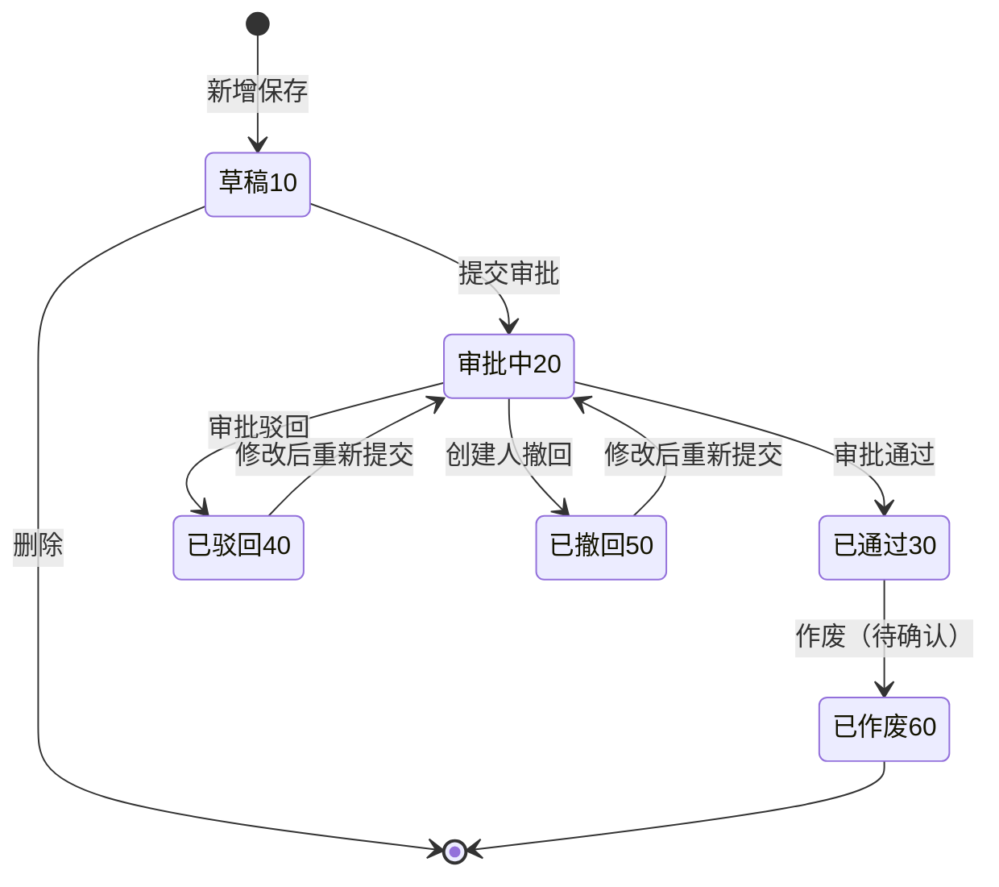

# 室外街正铺签约确认 需求分析

> 需求级别：M ｜ 目标模块：MRS/室外街商机管理 ｜ 迭代标识：2026-11-11-室外街正铺签约确认
> 分析日期：2026-11-11 ｜ 代码核验：否 ｜ 新建对象：是
> 分析依据：《室外街商机管理业务方案文档》V1.1（§2.1、§3.2、§3.3、§4.2 R04、§6）、初始版本 PRD V1.3 中 50/60 阶段相关章节、本次需求描述
> 约束：不读取任何前后端源码、UI5 代码、SAP 后端代码、数据库表结构或常用 SQL；新增对象仅使用业务逻辑名称，不虚构物理表名/字段名/接口路径/程序名

---

## 一、需求分析过程

### 1.1 模块认知摘要

#### 1.1.1 模块定位

室外街商机管理是悦招商平台面向**室外街**招商场景的独立模块，与既有"商机管理"同属商业地产招商业务域，但数据对象独立建设，不依赖商机管理数据表，仅对齐命名风格与状态/阶段编码口径。模块覆盖"手动录入/批量导入 → 跟进 → 进度里程碑 → 终止/恢复 → 达成交接外部合同流程 → 满 90 天开源"的完整生命周期。

#### 1.1.2 现有功能全景（10 个功能模块，均 P0）

| 模块 | 现有能力 | 与本次需求的关系 |
|------|---------|----------------|
| 商机录入 | 6 种来源手动创建，负责人默认为录入人，状态直接进入 20 跟进中 | 本次单据的商机来源；不改造 |
| 商机导入 | Excel 批量导入，全量校验通过才入库 | 不涉及 |
| 商机列表 | 组合查询，状态默认 20/30，阶段倒序排序 | 不涉及 |
| 商机详情 | 商机信息/商机进度/商机信息调整记录三分节；已达成展示合同签署日期 | 本次回写后由该页体现 50/60 结果，不改造 |
| 商机修改 | 仅负责人可改，50 已达成不可改 | 不涉及 |
| 负责人更换 | 按组织层级批量更换负责人 | 本次需考虑换人后单据快照/权限影响（待确认） |
| 协同人管理 | 负责人管理协同人 | 不涉及 |
| 进度管理 | 10~40 阶段手动新增；50/60 阶段禁止新增；60 由外部触发落一条进度 | 本次审批通过时需落一条 60 进度记录 |
| 终止/恢复 | 20/30 可终止，40 可恢复，50 不可终止 | 本次审批中的商机被终止时需定义处理规则（待确认） |
| 商机开源库 | 已终止满 90 天/已签约满 90 天自动开源，配置岗位只读查看 | 审批通过后开始计算 90 天，作废场景需考虑计时清除（待确认） |

#### 1.1.3 现有数据模型（10 张新增业务表，业务逻辑名称）

| 业务对象 | 关键业务字段 | 本次使用方式 |
|---------|-------------|-------------|
| 商机主表 | 商机编号、来源、品牌、业态、需求面积、负责人、状态、当前阶段、合同签署日期、是否开源、开源日期、归属组织等 | 回写当前阶段/状态/合同签署日期/最新进度日期 |
| 商机进度表 | 关联商机、阶段、内容、租金、管理费、免租期、意向金、看场照片、创建人/时间 | 审批通过时新增一条阶段 60 记录 |
| 商机协同人表 | 关联商机、协同人、角色、有效标记 | 不涉及 |
| 铺位关联表 | 关联进度、铺位编号、唯一标识、铺位类型、所属项目 | 本次单据需独立的单据-铺位关联，不复用进度铺位关联（见 §5） |
| 阶段配置表 | 10~60 阶段名称 | 只读引用 |
| 来源配置表 | A~F 来源名称 | 不涉及 |
| 流水号表 | 日期、当日流水号 | 可复用流水机制生成单据编号（待确认） |
| 导入记录表 | 导入批次 | 不涉及 |
| 管理岗位配置表 | 岗位层级/组织/岗位代码/在岗人 | 本次操作权限可参考（待确认） |
| 任务执行日志表 | 后台任务执行留痕 | 不涉及（本次无定时任务） |

#### 1.1.4 现有商机状态机与阶段体系

- **商机状态**：20 跟进中 / 30 已停滞 / 40 已终止 / 50 已达成（已签约）。
- **跟进阶段**：10 初始接洽 / 20 邀约看场 / 30 品牌回价 / 40 意向确认 / 50 合同审批 / 60 合同签署。
- **R04 已定口径**：50/60 阶段不手动新增，由两个外部场景触发——①室外街多经合同；②室外街合同确认。场景②原文为"室外街合同确认发起 → 合同审批(50)，审批完成 → 合同签署(60)"，且整体方案 §2.1 明确标注"室外街合同确认（具体需求后续补充）"。
- **R04/§3.2 回退口径**：合同撤回/作废 → 回退至原阶段，商机状态回 20。
- **R04/§3.3 落地口径**：更新至 60 时商机状态自动变 50 已达成，冗余写入合同签署日期；进度表落一条阶段 60 记录。
- **既有约束**：当前阶段 50/60 不可新增进度；50 已达成不可修改、不可终止；已签约满 90 天自合同签署日期起算开源。

#### 1.1.5 本次需求与现有功能的关系（核心结论）

1. **本次需求即 R04 场景②的正式落地**：新增"室外街正铺签约确认"独立菜单与"签约确认单"单据，作为室外街合同确认的发起载体；单据审批结果回写商机 50/60。
2. **不是商机详情内的子功能，也不是商机列表的新操作**：签约确认单是独立单据对象、独立列表页/详情页、独立流程审批，与商机为"多对一关联 + 回写"关系。
3. **不新增商机状态/阶段枚举**：完全复用 20/30/40/50 与 10~60，仅新增单据自身的单据状态与审批状态。
4. **本模块首次引入本地审批单据**：现有模块的"合同审批"完全由外部场景触发，模块内没有审批单据；本次新增的流程审批能力需复用平台既有流程审批组件，业务侧只定义表单、状态与回写规则。
5. **商机侧展示无需改造**：商机详情已支持"已达成展示合同签署日期"、进度分节已支持 60 阶段记录展示，本次回写后自然呈现。
6. **铺位口径与现有进度选择器存在差异**：现有进度的铺位选择器可选"室外街多经 + 室外街铺位"（两类）；本次为"正铺签约确认"，按需求语义应仅取室外街正铺（室外街铺位），需确认（见 Q18）。

### 1.2 需求解析摘要

| 维度 | 内容 |
|------|------|
| 业务场景 | 室外街招商人员与商户就正铺达成租赁意向后，发起"正铺签约确认"单据，登记签约时间、铺位、面积、品牌、业态、租金、合同期、付款方式、免租期及三类附件，提交流程审批；审批通过后商机进入合同签署阶段并标记已达成，支撑后续开源计时 |
| 核心目标 | ①为"室外街合同确认"提供可操作的单据入口；②将签约关键要素结构化留痕；③通过审批流控制签约确认的合规性；④审批结果自动回写商机 50/60，替代人工判断 |
| 涉及用户 | 室外街招商人员（发起/编辑/提交）、各级室外街招商负责人（审批，具体节点待确认）、单据创建人（撤回/查看） |
| 涉及模块 | MRS/室外街商机管理（主模块）、平台流程审批组件、组织树服务、品牌库、室外街业态表、铺位选择器、附件机制、标准变更日志、消息组件（是否通知待确认） |
| 主要输入 | 商机（非已达成/非已终止）、铺位（室外街正铺）、品牌、业态、租金、合同期、付款方式、免租期、三类附件 |
| 主要输出 | 签约确认单（列表/详情/审批状态）、商机阶段 50/60、商机状态 50、合同签署日期、60 阶段进度记录、变更日志 |

### 1.3 现有资产复用分析

| 复用点 | 现有口径 | 本次用法 | 待确认点 |
|--------|---------|---------|---------|
| 商机主表 | 阶段/状态/合同签署日期/最新进度日期 | 提交/通过/回退时回写 | 回写时点、回退口径、合同签署日期取值 |
| 商机进度表 | 60 阶段由外部触发落一条记录 | 审批通过时落一条阶段 60 记录 | 进度内容、创建人、创建时间取值 |
| 铺位选择器（ZSTRE0011B） | 进度选择器可选室外街多经 + 室外街铺位（MTYPE C/D），按商机归属组织过滤 | 正铺签约仅选室外街正铺，按商机所属项目过滤 | 铺位类型、可选状态、面积字段 |
| 品牌库（ZSTRE0002） | 商机品牌为联想选择，带出品牌 ID | 需求描述为"文本"，需确认是否沿用品牌库 | 品牌取值方式 |
| 室外街业态表（ZSTRE0005） | 仅取第一级（业态分类=1），只读引用 | 业态下拉数据源 | 是否默认带出商机业态 |
| 用户主表（ZSTFI0000A） | 人员姓名映射、离职判断 | 商机负责人/人员组织来源 | 组织取数口径 |
| 组织表/组织树服务（ZSTFI0000E） | 组织名称/层级、数据权限过滤 | 人员组织展示与列表数据权限 | 数据权限范围 |
| 项目表（ZSTRE0007） | 项目信息/简称 | 铺位范围、列表展示（可选） | 是否展示项目 |
| 附件表（ZSTRE0000） | 进度看场照片存 URL | 三类附件存 URL | 格式/大小/数量、附件分类关联方式 |
| 标准变更日志 | 商机创建/修改/阶段更新等记录 | 单据创建/提交/审批/回退记录 | 是否纳入商机变更日志 |
| 流水号机制 | 商机编号 5 位流水 | 单据编号生成 | 是否复用/新前缀 |
| 流程审批组件 | 平台既有流程审批能力 | 单据提交、审批、回调 | 审批节点、表单、回调范围 |
| 小新消息组件 | 6 类商机消息 | 审批结果通知（需求未提） | 是否需要 |

### 1.4 与商机阶段/状态联动：已定口径与待确认

#### 已定口径（直接沿用，不再重复确认）

| 编号 | 已定口径 | 来源 |
|------|---------|------|
| K1 | 50/60 阶段不手动新增，仅由外部场景触发 | R04 |
| K2 | 室外街合同确认发起 → 商机进入合同审批 50 | R04 |
| K3 | 室外街合同确认审批完成 → 商机进入合同签署 60 | R04 |
| K4 | 更新至 60 时商机状态自动变 50 已达成 | R04/§3.3 |
| K5 | 更新至 60 时冗余写入合同签署日期 | §3.3/§4.2 |
| K6 | 更新至 60 时进度表落一条阶段 60 记录 | §3.3/初始 PRD 5.7.1 |
| K7 | 合同撤回/作废 → 回退至原阶段，商机状态回 20 | §3.2/R04 |
| K8 | 当前阶段 50/60 不可新增进度；50 已达成不可修改、不可终止 | R11/R06 |
| K9 | 已签约商机自合同签署日期起满 90 天开源 | R15 |
| K10 | 外部阶段更新需记录变更日志 | §3.5/§6.2 |

#### 待确认口径（本次分析需用户决策）

| 编号 | 待确认点 | 影响 |
|------|---------|------|
| P1 | "合同确认发起"是保存草稿、提交审批还是审批通过才更新商机 | 决定 50 阶段进入时点 |
| P2 | 驳回/撤回/作废是否均回退商机原阶段 | 决定商机是否会长期停留在 50 |
| P3 | "原阶段"如何保存（单据冗余/商机新增字段/取最近进度） | 决定回退准确性与数据模型 |
| P4 | 商机"合同签署日期"取单据签约时间还是审批通过日期 | 影响详情展示与 90 天开源计时 |
| P5 | 提交审批时商机为 30 已停滞，是否置为 20 | 影响状态一致性 |
| P6 | 商机选择是否叠加"当前阶段非 50/60"限制 | 防止与多经合同场景重复占用 |
| P7 | 审批中商机被终止/被其他合同占用时的处理 | 影响异常闭环 |
| P8 | 已通过单据作废后，商机阶段/状态/签署日期/60 进度/开源计时如何回退 | 影响数据一致性 |

### 1.5 章节适用性预判（M 级极简 PRD）

| 模板章节 | 是否适用 | 理由 |
|---------|---------|------|
| 1. 需求背景 | 否 | M 级按极简结构，不输出 |
| 2. 需求概述 | 否 | M 级按极简结构，不输出 |
| 3. 功能模块 | 否 | M 级按极简结构，不输出 |
| 4. 表结构设计 | 是 | 新增签约确认单主表、铺位关联、附件关联等业务对象，需字段级说明 |
| 5. 功能详述 | 是 | 列表页、详情页、提交审批、商机回写、异常边界 |
| 6. 接口 | 视确认 | 流程审批为平台内部组件；按"接口仅指与外部系统交互"口径，若确认对接外部流程平台则输出，否则不输出 |
| 7. 后台任务 | 否 | 本次无定时任务；审批回调为事件驱动 |
| 8. 关键函数/类 | 否 | M 级不输出 |
| 9. 非功能需求 | 否 | 无特殊性能/安全要求（审批组件能力由平台保障） |

### 1.6 关键风险与设计取舍（分析阶段提示）

| 风险 | 说明 | 处理建议 |
|------|------|---------|
| 品牌"文本"与品牌库口径冲突 | 现有商机品牌必须走品牌库联想并落品牌 ID；需求写"文本" | 建议沿用品牌库联想，允许修改，最小化与商机口径的割裂（Q16） |
| 商机选择范围不足 | 需求仅排除"已达成/已终止"，但阶段 50 的商机状态仍为 20，会被选中，造成重复签约 | 建议叠加"当前阶段非 50/60"（Q7） |
| 合同签署日期口径 | R04 原口径为"当前日期"，需求新增"签约时间"字段 | 建议以签约时间为准，兼顾业务真实性与开源计时（Q5） |
| 回退原阶段无载体 | 商机主表无"合同前阶段"字段 | 建议在单据上冗余保存发起前阶段（Q4） |
| 已通过后作废的数据一致性 | 涉及阶段/状态/签署日期/60 进度/开源标记 | 建议限定作废场景并明确回退清单（Q12） |
| 审批中商机被自动终止 | 60 天无进度任务可能终止审批中的商机 | 建议提交/审批通过时二次校验（Q13） |

---

## 二、列表页设计方案

### 2.1 列表行对象与粒度

- **行对象**：签约确认单（一张单据一行），不是商机行，也不是铺位行。
- **推荐粒度**：一张单据一行，多个铺位在"铺位号"列合并展示（超过 2 个显示"铺位A、铺位B 等N个"），面积显示合计值；点击"查看"进入详情查看铺位明细。
- 备选：一张单据按铺位拆多行（便于按铺位检索，但单据信息重复、操作易误判）；主行 + 展开子行（实现复杂度高）。需确认（Q15）。

### 2.2 显示字段清单

| 序号 | 字段 | 数据来源 | 展示规则 | 展示建议 |
|:----:|------|---------|---------|---------|
| 1 | 单据编号 | 签约确认单主表 | 单据唯一编号，可点击进入详情 | 固定左侧 |
| 2 | 商机编号 | 关联商机 | 关联商机的编号 | 默认 |
| 3 | 商机跟进人 | 关联商机的负责人（单据快照） | 姓名；同名时建议"姓名（账号）" | 默认 |
| 4 | 人员组织 | 商机负责人所属组织（单据快照） | 组织名称；跨层级时可显示组织路径 | 默认 |
| 5 | 品牌 | 单据品牌 | 文本展示 | 默认 |
| 6 | 经营业态 | 业态表名称解析 | 显示业态名称 | 默认 |
| 7 | 铺位号 | 单据-铺位关联 | 多铺合并展示，超出折叠 | 默认 |
| 8 | 面积（㎡） | 单据面积合计 | 保留 2 位小数 | 默认 |
| 9 | 租金（元/㎡/月） | 单据租金 | 保留 2 位小数 | 默认 |
| 10 | 合同期 | 单据合同开始/结束日期 | 统一格式"YYYY年MM月DD日-YYYY年MM月DD日" | 默认 |
| 11 | 签约时间 | 单据签约时间 | 格式"YYYY年MM月DD日" | 默认 |
| 12 | 付款方式 | 单据付款方式 | 月度/季度/半年度/年度/其他 | 可选 |
| 13 | 单据状态 | 单据状态 | 草稿/审批中/已通过/已驳回/已撤回/已作废（建议带颜色标识） | 固定右侧或默认 |
| 14 | 当前审批节点 | 流程审批组件 | 仅审批中展示，如"项目负责人审批" | 可选 |
| 15 | 创建人 | 单据创建人 | 姓名 | 可选 |
| 16 | 创建时间 | 单据创建时间 | 格式"YYYY-MM-DD HH:mm" | 可选 |
| 17 | 更新时间 | 单据修改时间 | 格式"YYYY-MM-DD HH:mm" | 可选 |

> 说明：列表默认展示 1~11、13 共 12 列；12、14~17 作为可选列由用户配置或折叠展示。是否展示"商机当前阶段/状态"待确认（可辅助判断回写结果，但会增加列宽）。

### 2.3 筛选项清单

| 分组 | 筛选项 | 控件类型 | 匹配规则 | 默认值 |
|------|--------|---------|---------|--------|
| 常用 | 单据编号 | 文本输入 | 模糊匹配（建议支持精确开关） | 空 |
| 常用 | 商机跟进人 | 人员选择器（单选） | 按负责人账号精确匹配 | 空 |
| 常用 | 品牌 | 文本输入 | 模糊匹配 | 空 |
| 常用 | 经营业态 | 下拉多选（业态表，仅业态分类=1 且未删除） | 多值 OR | 空 |
| 常用 | 单据状态 | 下拉多选 | 多值 OR | 待确认（建议默认"审批中+已驳回"，可清空） |
| 常用 | 签约时间 | 日期范围选择 | 闭区间 | 空 |
| 更多 | 商机编号 | 文本输入 | 模糊匹配 | 空 |
| 更多 | 铺位号 | 文本输入 | 模糊匹配，命中该单据任一铺位即返回 | 空 |
| 更多 | 人员组织 | 组织树选择（权限范围内） | 含下级组织 | 空 |
| 更多 | 合同期 | 日期范围选择（按合同开始日期或结束日期） | 闭区间 | 空 |
| 更多 | 创建人 | 人员选择器 | 精确匹配 | 空 |
| 更多 | 创建时间 | 日期范围选择 | 闭区间 | 空 |

> 建议首版保留 6 个常用筛选 + 4~6 个更多筛选，避免筛选项过多影响易用性。合同期筛选的匹配字段（开始/结束/区间重叠）需在 PRD 明确。

### 2.4 默认排序、分页与空态

| 项 | 方案 |
|----|------|
| 默认排序 | 创建时间倒序 → 单据编号倒序（建议） |
| 可选排序 | 签约时间、合同结束日期、更新时间（建议支持点击表头排序） |
| 分页 | 服务端分页，默认每页 20 条，可选 20/50/100，展示总条数 |
| 空态 | "暂无签约确认单"；筛选无结果时"未找到符合条件的签约确认单，请调整筛选条件" |
| 加载/异常 | 加载中骨架或 loading；接口异常提示"数据加载失败，请稍后重试"，保留筛选条件 |

### 2.5 列表操作按钮（按状态区分）

| 单据状态 | 查看 | 编辑 | 提交审批 | 撤回 | 删除 | 作废 |
|---------|:----:|:----:|:-------:|:----:|:----:|:----:|
| 10 草稿 | 是 | 是 | 是 | 否 | 是（建议） | 否 |
| 20 审批中 | 是 | 否 | 否 | 是（仅创建人） | 否 | 否 |
| 30 已通过 | 是 | 否 | 否 | 否 | 否 | 待确认（建议支持，见 Q12） |
| 40 已驳回 | 是 | 是 | 是（重新提交） | 否 | 待确认 | 否 |
| 50 已撤回 | 是 | 是 | 是（重新提交） | 否 | 待确认 | 否 |
| 60 已作废 | 是 | 否 | 否 | 否 | 否 | 否 |

补充规则：
- 列表顶部提供"新增"按钮；是否提供批量提交审批、批量删除待确认（建议首版仅单行操作）。
- 无权限的按钮不显示；状态不满足的按钮置灰或隐藏（建议隐藏，避免误解）。
- "查看"所有状态均可用；审批中/已通过/已作废均为全只读。
- 删除建议仅草稿可删且仅创建人可删；物理删除或逻辑删除待确认（Q34）。

### 2.6 数据权限范围（建议，待确认）

| 层级 | 建议数据范围 |
|------|-------------|
| 项目 | 人员组织为本项目及下级的单据 |
| 区域 | 人员组织为本区域及下级的单据 |
| 事业部 | 全部单据 |
| 创建人 | 始终可见本人创建的单据（即使组织权限变化） |
| 审批人 | 审批中的待办单据通过流程平台待办进入，不受列表数据权限影响 |

> 说明：按"人员组织"（商机负责人组织）还是"创建人组织"过滤需确认（Q33）；两者可能不一致。开源库的"接口层放开组织权限"口径不适用于本列表。

---

## 三、详情页字段设计

### 3.1 基本信息字段

| 序号 | 字段 | 必填 | 控件类型 | 取数来源/默认值 | 校验与联动 | 可编辑状态 |
|:----:|------|:----:|---------|----------------|-----------|-----------|
| 1 | 单据编号 | 系统 | 文本（只读） | 保存时按编号规则生成 | 唯一 | 始终只读 |
| 2 | 单据状态 | 系统 | 文本（只读） | 单据状态机 | 按状态控制页面只读 | 始终只读 |
| 3 | 签约时间 | 是 | 日期选择（到日） | 无默认值 | 必填；是否允许未来日期待确认 | 草稿/已驳回/已撤回可编辑 |
| 4 | 商机跟进人 | 是 | 商机选择弹窗（单选） | 弹窗选择商机，带出商机负责人 | 仅可选商机状态 20/30（是否叠加阶段非 50/60 待确认）；选中后带出负责人、人员组织、品牌默认值 | 草稿/已驳回/已撤回可编辑 |
| 5 | 人员组织 | 系统 | 文本（只读） | 根据商机负责人所属组织自动带出 | 随商机变化；是否快照待确认 | 始终只读 |
| 6 | 铺位号 | 是 | 铺位选择器（多选） | 按商机所属项目过滤，仅室外街正铺 | 至少 1 个；同一铺位不可重复；是否限制空铺待确认 | 草稿/已驳回/已撤回可编辑 |
| 7 | 面积（㎡） | 系统 | 数字（只读） | 根据所选铺位面积合计 | 无面积铺位是否可选待确认；保留 2 位小数 | 始终只读 |
| 8 | 品牌 | 是 | 文本或品牌联想（待确认） | 默认带出商机品牌 | 必填；支持修改；不反写商机 | 草稿/已驳回/已撤回可编辑 |
| 9 | 经营业态 | 是 | 下拉单选（业态表） | 业态表业态分类=1 且未删除的数据 | 必填；是否默认商机业态待确认 | 草稿/已驳回/已撤回可编辑 |
| 10 | 租金（元/㎡/月） | 是 | 数字输入 | 无默认值 | 必填；大于 0；保留 2 位小数（待确认） | 草稿/已驳回/已撤回可编辑 |
| 11 | 合同期 | 是 | 日期范围（开始/结束） | 无默认值 | 必填；结束日期≥开始日期（是否允许同日待确认） | 草稿/已驳回/已撤回可编辑 |
| 12 | 付款方式 | 是 | 下拉单选 | 月度/季度/半年度/年度/其他 | 必填；选"其他"是否需补充说明待确认 | 草稿/已驳回/已撤回可编辑 |
| 13 | 免租期（天） | 是 | 数字输入（整数） | 无默认值 | 必填；≥0；是否≤合同期天数待确认 | 草稿/已驳回/已撤回可编辑 |
| 14 | 备注说明 | 否 | 多行文本 | 无 | 长度上限待确认（建议 500 字） | 草稿/已驳回/已撤回可编辑 |

> 合同期展示格式统一为"YYYY年MM月DD日-YYYY年MM月DD日"（列表与详情一致）；未填写完整时显示"-"。

### 3.2 附件字段

| 序号 | 附件类别 | 必传 | 数量 | 格式/大小（建议，待确认） | 存储与复用 |
|:----:|---------|:----:|------|------------------------|-----------|
| 1 | 租赁合同 | 是 | 至少 1 个，支持多个 | pdf/jpg/png，单文件≤10MB，单类≤9 个 | 复用附件表（ZSTRE0000）存 URL，新增单据附件关联 |
| 2 | 身份证明材料（营业执照、身份证复印件等） | 是 | 至少 1 个，支持多个 | pdf/jpg/png，单文件≤10MB，单类≤9 个 | 同上 |
| 3 | 首期租金及押金付款凭证 | 是 | 至少 1 个，支持多个 | pdf/jpg/png，单文件≤10MB，单类≤9 个 | 同上 |

附件规则：
- 支持上传、预览、下载、删除（仅可编辑状态下可删）。
- 必传数量校验建议在"提交审批"时执行；草稿保存是否允许附件为空待确认（Q10）。
- 三类附件分别独立计数，不可互相替代。
- 建议展示文件名、大小、上传人、上传时间。

### 3.3 审批信息区（只读）

| 字段 | 来源 | 展示规则 |
|------|------|---------|
| 审批状态 | 流程审批组件/单据状态 | 未提交/审批中/已通过/已驳回/已撤回/已作废 |
| 当前审批节点 | 流程审批组件 | 审批中展示；其他状态为空 |
| 当前审批人 | 流程审批组件 | 审批中展示 |
| 审批意见 | 流程审批组件 | 显示最近一次审批意见；完整记录可展开 |
| 审批时间 | 流程审批组件 | 显示最近一次审批时间 |
| 审批记录 | 流程审批组件 | 提供"查看审批记录/流程图"入口 |

> 审批信息区在所有状态下只读；审批中的单据整页只读。

### 3.4 字段联动关系汇总

| 触发动作 | 联动结果 | 备注 |
|---------|---------|------|
| 选择商机 | 带出商机负责人 → 商机跟进人；带出负责人所属组织 → 人员组织；带出商机品牌 → 品牌默认值 | 品牌可修改；人员组织只读 |
| 选择商机（与原商机不同） | 清空已选铺位与面积；品牌重新带默认值 | 避免跨项目铺位残留；是否需要二次确认待确认 |
| 选择/取消铺位 | 面积 = 所选铺位面积合计 | 只读；无面积铺位是否阻断待确认 |
| 修改合同期 | 校验结束日期≥开始日期；免租期上限随之校验（如启用） | 免租期与合同期关系待确认 |
| 选择"其他"付款方式 | 是否显示补充说明输入框 | 待确认 |
| 切换单据状态 | 控制整页字段可编辑性、按钮可见性 | 见 §3.5 |
| 提交审批 | 全量必填/附件校验 → 锁定页面 → 回写商机 50 | 校验失败逐项提示 |

### 3.5 详情页编辑规则矩阵

| 单据状态 | 字段可编辑 | 附件可增删 | 可提交审批 | 可撤回 | 可删除 | 说明 |
|---------|:----------:|:----------:|:----------:|:------:|:------:|------|
| 10 草稿 | 是 | 是 | 是 | 否 | 是 | 可反复保存 |
| 20 审批中 | 否 | 否 | 否 | 是（创建人） | 否 | 整页只读 |
| 30 已通过 | 否 | 否 | 否 | 否 | 否 | 终态只读；作废另议 |
| 40 已驳回 | 是 | 是 | 是 | 否 | 待确认 | 修改后重新提交 |
| 50 已撤回 | 是 | 是 | 是 | 否 | 待确认 | 修改后重新提交 |
| 60 已作废 | 否 | 否 | 否 | 否 | 否 | 终态只读 |

---

## 四、单据状态机与审批联动

### 4.1 单据状态定义（建议）

| 编码 | 状态 | 含义 | 可执行操作 |
|:----:|------|------|-----------|
| 10 | 草稿 | 已保存未提交，商机不受影响 | 编辑、提交审批、删除 |
| 20 | 审批中 | 已提交流程审批，页面锁定 | 查看、撤回（创建人） |
| 30 | 已通过 | 审批通过，商机已回写 60/50 | 查看（作废另议） |
| 40 | 已驳回 | 审批驳回，可修改后重新提交 | 查看、编辑、重新提交 |
| 50 | 已撤回 | 创建人主动撤回，可修改后重新提交 | 查看、编辑、重新提交 |
| 60 | 已作废 | 单据作废，终态 | 查看 |

> 状态编码与命名参考平台既有单据风格（如品牌管理 10 未提交/20 审批中/30 已审批/40 已驳回/60 已作废），本方案新增 50 已撤回；最终编码以研发确认为准，本文仅表达业务状态。

### 4.2 单据状态流转



### 4.3 审批流节点（业务描述，待确认）

建议采用平台既有流程审批组件，业务侧定义如下内容：

1. **发起节点**：招商人员完成单据填写并提交，进入审批。
2. **审批节点**：按组织层级审批，建议为"项目室外街招商负责人 → 区域室外街招商负责人（按需）→ 事业部室外街招商负责人（按需）"，是否全部层级参与、是否按租金/面积分级审批待确认。
3. **审批动作**：同意、驳回（必填意见）、撤回（发起人）。
4. **审批结果**：通过/驳回/撤回均需回调本模块，驱动单据状态与商机回写。
5. **审批表单**：展示单据关键字段与三类附件，是否展示商机原始信息待确认。

> 具体审批人、节点数与跳转条件由流程平台配置，本文不虚构流程编码/接口。

### 4.4 商机回写矩阵（核心）

| 事件 | 单据状态 | 商机当前阶段 | 商机状态 | 合同签署日期 | 商机进度 | 商机最新进度日期 | 变更日志 |
|------|---------|-------------|---------|-------------|---------|----------------|---------|
| 保存草稿 | 10 草稿 | 不变 | 不变 | 不变 | 不变 | 不变 | 单据创建日志（建议） |
| 提交审批 | 20 审批中 | 更新为 50 合同审批 | 保持 20；若原为 30 是否置 20 待确认 | 不变 | 不落进度（50 不落进度） | 不变 | 记录阶段更新 |
| 审批通过 | 30 已通过 | 更新为 60 合同签署 | 更新为 50 已达成 | 写入（取值口径待确认） | 新增一条阶段 60 进度 | 更新为审批通过时间 | 记录阶段更新 |
| 审批驳回 | 40 已驳回 | 回退至发起前阶段 | 回 20 | 不变 | 无 | 不变 | 记录回退 |
| 创建人撤回 | 50 已撤回 | 回退至发起前阶段 | 回 20 | 不变 | 无 | 不变 | 记录回退 |
| 已通过后作废 | 60 已作废 | 回退至发起前阶段 | 回 20 | 清空（建议） | 60 进度如何处理待确认 | 待确认 | 记录作废回退 |

补充说明：
- "发起前阶段"建议在提交审批时冗余保存在单据上（Q4）。
- 商机状态 40 已终止时不允许提交；商机状态 50 已达成时不允许选择/提交。
- 审批通过后商机 50 已达成，按既有规则不可修改、不可终止、不可新增进度。
- 审批通过后 90 天开源计时以商机"合同签署日期"为起点；若作废后清除签署日期，应同步清除开源标记并停止计时（Q12）。

### 4.5 异常与边界场景（分析阶段识别）

| 场景 | 建议处理 | 待确认 |
|------|---------|--------|
| 提交审批时商机已终止(40) | 拒绝提交，提示"商机已终止，不能发起签约确认" | — |
| 提交审批时商机已达成(50) | 拒绝提交，提示"商机已达成，不能重复发起签约确认" | — |
| 审批中商机被手动/自动终止 | 建议审批通过时再次校验，失败则单据转已驳回/异常并提示 | Q13 |
| 审批中商机被其他合同场景占用（阶段变 50/60） | 建议审批通过时校验阶段，冲突则阻断并提示 | Q13 |
| 审批中商机负责人更换 | 单据按快照展示原负责人；列表数据权限按快照还是最新负责人待确认 | Q25/Q33 |
| 审批中铺位被其他单据占用 | 建议提交与审批通过时校验铺位可用性 | Q9 |
| 流程重复回调 | 以流程实例+单据状态做幂等，重复回调不重复回写 | Q30 |
| 并发提交同一单据 | 后端加锁/状态校验，仅允许一次有效提交 | — |
| 审批通过回写商机失败 | 事务回滚或补偿重试，单据不得单独置为已通过 | Q30 |
| 附件未传齐 | 提交审批时阻断并逐项提示 | Q10 |
| 商机品牌为空 | 商机品牌本身必填，正常不会出现；若为空则品牌需手工填写 | — |
| 铺位面积为空 | 建议该铺位不可选或阻断提交 | Q20 |

---

## 五、数据对象与表结构分析

> 本章新增对象仅使用业务逻辑名称，物理表名/字段名/类型长度/索引由技术设计阶段确定，本文不虚构。

### 5.1 复用对象

| 对象（业务/现有物理名） | 用途 | 使用方式 |
|------------------------|------|---------|
| 商机主表 | 关联商机、回写阶段/状态/合同签署日期/最新进度日期 | 读取 + 更新 |
| 商机进度表 | 审批通过时新增 60 阶段记录 | 新增 |
| 铺位表（ZSTRE0011B） | 铺位选择器数据源、铺位号、铺位类型、面积、所属项目 | 只读查询 |
| 品牌主表（ZSTRE0002） | 品牌联想/品牌 ID（若采用品牌库方式） | 只读查询 |
| 室外街业态表（ZSTRE0005） | 业态下拉数据源（业态分类=1 且未删除） | 只读查询 |
| 用户主表（ZSTFI0000A） | 商机负责人姓名、账号、所属组织 | 只读查询 |
| 组织表/组织树服务（ZSTFI0000E） | 人员组织展示、数据权限过滤 | 只读查询/调用 |
| 项目表（ZSTRE0007） | 铺位所属项目、列表展示（可选） | 只读查询 |
| 附件表（ZSTRE0000） | 三类附件 URL 存储 | 新增/查询/删除 |
| 流水号表 | 单据编号流水生成（若复用） | 读取/更新 |
| 标准变更日志 | 单据与商机阶段变更留痕 | 新增 |
| 流程审批组件 | 提交、审批、回调、审批记录 | 调用 |
| 小新消息组件 | 审批结果通知（若需要） | 调用 |

### 5.2 新增业务对象（建议）

| 序号 | 业务对象 | 用途 | 关键业务字段（业务逻辑名称） |
|:----:|---------|------|------------------------------|
| 1 | 签约确认单主表 | 单据唯一信息载体 | 单据编号（唯一）、单据状态、签约时间、关联商机标识/商机编号、商机跟进人（负责人账号/姓名快照）、人员组织（编码/名称快照）、品牌名称（及品牌 ID，若采用品牌库）、经营业态、面积合计、租金、合同开始日期、合同结束日期、付款方式、免租期天数、备注说明、发起前商机阶段、创建人、创建时间、修改人、修改时间、流程实例标识（审批用） |
| 2 | 签约确认单铺位关联表 | 单据与多个铺位的关联明细 | 关联单据、行号、铺位编号、铺位唯一标识、铺位类型、所属项目、铺位面积 |
| 3 | 签约确认单附件关联表 | 单据与三类附件的关联及分类 | 关联单据、附件类别（租赁合同/身份证明材料/付款凭证）、附件 URL、文件名、文件大小、上传人、上传时间、有效标记 |
| 4 | 单据编号流水表（或复用现有流水号表） | 单据编号按日流水生成 | 日期、当日流水号 |

> 附件对象优先评估复用现有附件机制的"业务对象类型"扩展能力；若现有机制不支持按单据+类别关联，则新增第 3 个对象。

### 5.3 需扩展的现有对象

| 对象 | 扩展内容 | 是否必要 |
|------|---------|---------|
| 商机主表 | 若"发起前阶段"不在单据冗余而落在商机主表，则需新增"合同前阶段"字段 | 取决于 Q4；建议不扩展（存单据） |
| 附件表（ZSTRE0000） | 若现有附件机制无业务对象类型/单据号字段，需扩展或新增关联对象 | 取决于现有实现（本次不读取代码，待研发核验） |
| 商机主表 | 合同签署日期已有，无需新增 | 否 |

### 5.4 关键关系

```
商机主表 1 ──── N 签约确认单（业务上同一商机同时仅允许一张有效单据，待确认）
签约确认单 1 ── N 签约确认单铺位关联（多选铺位）
签约确认单 1 ── N 签约确认单附件关联（三类附件，多个）
签约确认单 ──── 流程实例（审批）
签约确认单 ──── 商机进度（审批通过时新增 60 记录）
```

### 5.5 编号规则（建议，待确认）

- 建议签约确认单使用**独立单据编号**：固定前缀 + 日期（YYYYMMDD）+ 5 位流水，示例形式"前缀+20261111+00001"；前缀由业务确认（如"QY"），不沿用商机来源字母。
- 编号生成时点：建议首次保存时生成（草稿即占用编号），或提交审批时生成；需确认（Q27）。
- 流水生成复用排他锁 + 重试机制，与商机编号流水相互独立，避免互相挤占。

### 5.6 数据权限字段建议

- 单据主表冗余"人员组织"与"商机跟进人"，作为列表数据权限与展示的直接依据，避免每次关联商机实时取数。
- 冗余"商机编号/品牌/业态/铺位/面积"等展示字段，保证商机后续变更不影响历史单据展示（快照策略，待确认 Q25）。

---

## 六、确认问题清单

### 6.1 业务流程确认

**Q1. "室外街合同确认发起"对应本单据的哪个动作，商机何时进入 50 合同审批？**
- A. 保存草稿不影响商机；**提交审批**时商机进入 50，审批通过进入 60（推荐，贴合 R04"发起"语义，草稿可自由修改）
- B. 首次保存草稿即进入 50，审批通过进入 60
- C. 提交审批与审批通过都不写 50，审批通过时一次性写 60
> 建议 A。理由：草稿未形成正式发起，不应占用商机阶段；B 会导致废弃草稿污染商机；C 与 R04"发起→50"不符。

**Q2. 提交审批时商机为"30 已停滞"，是否置为 20 跟进中？**
- A. 置为 20 跟进中（推荐，与"当前阶段 50 时状态保持 20"的口径一致）
- B. 保持 30 不变
- C. 阻断提交，要求先新增进度使商机回到 20
> 建议 A。

**Q3. 审批驳回、创建人撤回、已通过后作废，是否都回退商机阶段与状态？**
- A. 驳回/撤回/作废均回退至发起前阶段，商机状态回 20（推荐，与多经合同撤回/作废口径一致）
- B. 仅撤回/作废回退，驳回保持 50 等待重新提交
- C. 均不回退，仅审批通过时写 60
> 建议 A。理由：驳回/撤回后合同并未成立，商机不应停留在合同审批阶段。

**Q4. 回退所需的"发起前阶段"如何保存？**
- A. 提交审批时在签约确认单上冗余保存发起前阶段（推荐，不影响商机主表，回退准确）
- B. 在商机主表新增"合同前阶段"字段
- C. 回退时取该商机最近一条 10~40 进度的阶段
> 建议 A。C 在无历史进度或进度被编辑时不准确。

**Q5. 商机"合同签署日期"取哪个日期？**
- A. 取本单据的"签约时间"（推荐，反映真实签约日期，开源计时更符合业务）
- B. 取审批通过日期（沿用 R04"当前日期"原口径）
- C. 取合同开始日期
> 建议 A。需同步修订整体方案 R04/K5 的"当前日期"表述；若选 B，签约时间仅作单据展示。

**Q6. 签约时间是否允许未来日期或晚于审批通过日期？**
- A. 允许选择任意日期，不做限制（推荐首版，避免业务补录受阻）
- B. 必须≤当前日期
- C. 必须≤当前日期且不得晚于合同开始日期
> 建议 A 或 B，请业务明确；若选 B/C 需定义提示语。

**Q7. 商机选择范围是否在"非已达成/非已终止"基础上，再排除当前阶段 50/60 的商机？**
- A. 是，仅可选商机状态 20/30 且当前阶段 10~40（推荐，避免与多经合同场景重复占用）
- B. 否，仅按需求字面排除状态 40/50
- C. 是，并同时排除已被其他有效签约确认单关联的商机
> 建议 A（C 与 Q8 合并处理）。若选 B，阶段 50 的商机仍可选，存在重复签约风险。

**Q8. 同一商机是否允许多张有效签约确认单并存？**
- A. 同一商机仅允许一张"未终结"单据（草稿/审批中/已驳回/已撤回），已通过或已作废后可再发起（推荐）
- B. 仅"审批中+已通过"唯一，草稿可多张
- C. 允许多张并行，不做唯一控制
> 建议 A。需明确"未终结"的范围。

**Q9. 同一铺位是否允许被多张有效单据同时占用？**
- A. 同一铺位在"草稿/审批中"单据中唯一，不允许重复选择（推荐）
- B. 仅"审批中"唯一，草稿可重复
- C. 不做占用校验，由审批人判断
> 建议 A。需明确校验时点（保存/提交/审批通过）。

**Q10. 草稿保存与提交审批的校验强度？**
- A. 草稿仅校验格式（日期、数字），必填项与三类附件在提交审批时强控（推荐）
- B. 草稿保存即执行全量必填与附件校验
- C. 草稿不校验，提交审批全量校验
> 建议 A。需明确"必填项"是否包含附件。

**Q11. 审批中撤回后，单据进入哪个状态？**
- A. 进入"50 已撤回"，可编辑并重新提交（推荐，保留撤回痕迹）
- B. 退回"10 草稿"，与普通草稿无区别
- C. 撤回即作废，需重新新建
> 建议 A。若平台流程组件不支持"已撤回"状态，则退化为 B。

**Q12. 已通过单据是否允许作废？作废后如何回退？**
- A. 允许创建人/管理岗作废，商机阶段回退至发起前阶段、状态回 20、清空合同签署日期与开源标记、60 进度记录标记无效或删除（推荐，需明确权限）
- B. 允许作废，但仅回退单据状态，商机保持 60/50 不回退
- C. 不允许作废，已通过即终态
> 建议 A 或 C；若选 A，需补充"已开源商机是否允许作废"（建议不允许）。

**Q13. 审批中商机被终止、被其他合同场景占用（阶段变 50/60）时如何处理？**
- A. 审批通过回调时二次校验商机状态/阶段，不满足则阻断回写，单据转"已驳回"并提示原因（推荐）
- B. 提交时校验一次，审批过程中不再校验，通过后强制回写
- C. 商机状态变化时自动作废关联的审批中单据
> 建议 A。

**Q14. 审批结果是否需要向创建人发送消息通知？**
- A. 需要，审批通过/驳回时发送小新消息（推荐，便于闭环）
- B. 不需要，用户在列表查看状态即可
> 需求未提及，建议 A；若不需要则减少集成点。

### 6.2 数据模型确认

**Q15. 列表行粒度？**
- A. 一张单据一行，多个铺位合并展示（推荐，符合单据管理习惯）
- B. 一张单据按铺位拆多行，便于按铺位检索
- C. 主行 + 展开子行查看铺位明细
> 建议 A，详情页展示铺位明细。

**Q16. 品牌字段采用何种方式？**
- A. 沿用品牌库联想选择，落品牌名称+品牌 ID，可修改（推荐，与商机品牌口径一致）
- B. 纯文本自由填写，不落品牌 ID（严格按需求字面"文本"）
- C. 品牌库联想为主，允许输入不存在的品牌（混合）
> 建议 A。若选 B，需接受无法按品牌 ID 关联、品牌改名不同步等限制。

**Q17. 经营业态是否默认带出商机业态？**
- A. 默认带出商机业态，允许修改（推荐，减少重复录入）
- B. 无默认值，必须手工选择（严格按需求字面）
> 需求仅明确品牌默认，未明确业态；建议 A，请确认。

**Q18. 铺位选择器的铺位类型范围？**
- A. 仅室外街正铺（室外街铺位，铺位类型 C）（推荐，符合"正铺签约"语义）
- B. 室外街正铺 + 室外街多经（C/D，与现有进度选择器一致）
- C. 仅标准正铺（铺位类型 A）
> 建议 A。需与现有铺位类型域（A 正铺 / B 多经 / C 室外街 / D 室外街多经）核对。

**Q19. 铺位可选状态范围？**
- A. 仅商机所属项目下、审批通过、未删除、未停用且未租赁的空铺（推荐，签约针对空铺）
- B. 审批通过、未删除、未停用即可，不限租赁状态
- C. 不做状态过滤，全部铺位可选
> 建议 A。需明确"未租赁"的判定口径，以及是否允许选择本商机历史进度已关联的铺位。

**Q20. 面积取数口径与多铺合计规则？**
- A. 取铺位租赁面积，多选合计，保留 2 位小数；无面积铺位不可选（推荐）
- B. 取铺位建筑面积，多选合计
- C. 每个铺位分行展示面积并给出合计
> 建议 A。面积字段名称与取值以研发核验铺位主数据为准，本文不指定物理字段。

**Q21. 合同期校验规则？**
- A. 结束日期≥开始日期，允许同日，不限制最长年限（推荐首版）
- B. 结束日期>开始日期，不允许同日
- C. 结束日期≥开始日期，且最长不超过 N 年（N 待业务给出）
> 建议 A 或 C，请业务明确是否限制年限。

**Q22. 租金、免租期、"其他"付款方式的补充规则？**
- A. 租金>0 且保留 2 位小数；免租期为≥0 的整数且≤合同期天数；付款方式选"其他"时需填写补充说明（推荐）
- B. 租金≥0；免租期≥0 不设上限；"其他"无需说明
- C. 其他规则（请说明）
> 建议 A。若选 B，免租期可能超过合同期，存在业务漏洞。

**Q23. 备注说明长度上限？**
- A. 500 字（推荐）
- B. 255 字（与商机需求概述一致）
- C. 1000 字
> 建议 A，请确认。

**Q24. 三类附件的格式、大小、数量限制？**
- A. pdf/jpg/png，单文件≤10MB，每类≤9 个（推荐，租赁合同通常为 PDF）
- B. 沿用看场照片限制：jpg/png，单张≤5MB，每类≤9 个
- C. 不限制格式，仅限制单文件大小与数量
> 建议 A。需明确是否允许 Word/Excel。

**Q25. "商机跟进人"字段形态与快照策略？**
- A. 字段为"选择商机"，列表/详情展示商机负责人姓名，落库商机标识+负责人账号/姓名+人员组织快照（推荐）
- B. 字段为"选择人员"，人员范围限定为非已达成/非已终止商机的负责人
- C. 字段为"选择商机"但不落快照，实时取商机负责人
> 建议 A。需明确商机换人后单据是否同步更新（建议不同步，保留签约时点信息）。

**Q26. 人员组织取数来源与展示？**
- A. 取商机负责人所属组织（用户组织），显示组织名称（推荐，按需求"用户组织"）
- B. 取商机归属组织
- C. 取创建人所属组织
> 建议 A。需明确负责人有多个组织时取哪一个（建议主组织/默认组织），以及是否显示组织全路径。

**Q27. 单据编号规则与生成时点？**
- A. 独立前缀 + YYYYMMDD + 5 位流水，首次保存时生成（推荐）
- B. 独立前缀 + YYYYMMDD + 5 位流水，提交审批时生成
- C. 沿用商机编号规则（来源字母+日期+流水）
> 建议 A。前缀请业务确认（如"QY"），不沿用来源字母以免与商机混淆。

### 6.3 接口/集成确认

**Q28. 流程审批采用何种对接方式与审批节点？**
- A. 复用平台既有流程审批组件，按组织层级配置审批节点（项目负责人→区域负责人→事业部负责人按需），业务只定义表单与回调（推荐）
- B. 本模块自定义固定审批节点（需业务给出节点与审批人规则）
- C. 按租金/面积/合同期等金额分级审批（需业务给出分级规则）
> 建议 A，并请业务确认是否需要分级审批。本文不虚构流程编码与接口。

**Q29. 审批表单需要展示哪些内容？**
- A. 展示单据全部关键字段 + 三类附件，可查看商机基本信息（推荐）
- B. 仅展示单据关键字段与附件，不展示商机信息
- C. 仅展示汇总字段，附件需另行查看
> 建议 A。需明确审批人是否可下载附件。

**Q30. 审批回调范围与幂等要求？**
- A. 通过/驳回/撤回/作废均回调；以流程实例+单据状态做幂等，重复回调不重复回写；回写失败需重试或补偿（推荐）
- B. 仅通过/驳回回调，撤回由本模块自行处理
- C. 仅通过回调，其余状态由用户手动操作
> 建议 A。

**Q31. 是否需要移动端或对外接口？**
- A. 首版仅 PC 端，不提供对外接口（推荐）
- B. 需要悦招商移动端支持发起/查看/审批
- C. 需要对外接口供其他系统查询签约确认结果
> 需求未提及，建议 A；若选 B/C 需追加范围与工作量。

### 6.4 权限确认

**Q32. 菜单与新增权限范围？**
- A. 与商机录入一致：室外街招商人员及各级室外街招商负责人均可新增（推荐）
- B. 仅项目/区域负责人可新增
- C. 通过独立岗位/角色配置控制
> 建议 A 或 C，请确认。

**Q33. 列表数据权限范围？**
- A. 与商机列表一致：按人员组织三级过滤（项目/区域/事业部），创建人始终可见本人单据（推荐）
- B. 仅本人创建的单据可见
- C. 本组织及下级全部可见，不区分负责人/协同人
> 建议 A。按"人员组织"还是"创建人组织"过滤需一并明确。

**Q34. 编辑、删除、撤回、作废的操作权限？**
- A. 编辑/提交/删除/撤回仅创建人；作废由创建人或对应层级管理岗；审批人仅审批（推荐）
- B. 创建人及本组织管理岗均可编辑/删除/撤回
- C. 仅创建人，管理岗无代操作权限
> 建议 A。需明确删除是物理删除还是逻辑删除，以及附件是否同步清理。

### 6.5 计划确认

**Q35. 存量已进入 50/60 的商机是否需要补录签约确认单？**
- A. 不补录，仅新流程产生的签约确认单纳入（推荐，存量已由多经合同/其他场景触发）
- B. 需要为存量 60 商机补录历史单据
- C. 仅补录某时间之后的存量
> 建议 A，避免与既有数据重复。

**Q36. 是否需要导出、打印或批量操作？上线范围如何？**
- A. 首版不提供导出/打印/批量操作，仅列表查询与单行操作（推荐）
- B. 需要列表导出 Excel
- C. 需要批量提交审批/批量删除
> 建议 A；如需要请明确模板字段与权限。

---

## 七、确认结果

> 确认日期：2026-11-11 ｜ 确认方式：用户逐题确认（未单独列出的题目均按分析文档推荐项采纳）

### 7.1 业务流程（Q1~Q14）

| 编号 | 采纳结论 |
|:----:|---------|
| Q1 | 保存草稿不影响商机；**提交审批**时商机进入 50 合同审批，审批通过进入 60 |
| Q2 | 提交审批时商机为 30 已停滞的，置为 20 跟进中 |
| Q3 | 审批驳回、创建人撤回均回退商机至发起前阶段、商机状态回 20（作废场景已随 Q12 取消） |
| Q4 | 提交审批时在签约确认单上冗余保存“发起前阶段” |
| Q5 | 商机“合同签署日期”取**审批通过回调、更新商机至 60 时的日期**，不取单据“签约时间” |
| Q6 | 签约时间不限制未来日期 |
| Q7 | 商机选择在“非已达成、非已终止”基础上，叠加“当前阶段非 50/60” |
| Q8 | 同一商机仅允许一张未终结单据（草稿/审批中/已驳回/已撤回） |
| Q9 | **仅“审批中”单据占用铺位**；草稿不占用。提交审批时校验该铺位是否已被其他审批中单据占用 |
| Q10 | 草稿保存仅校验格式；必填项与三类附件在提交审批时强控 |
| Q11 | 创建人撤回后进入 **50 已撤回**，可编辑并重新提交 |
| Q12 | **已通过单据不允许作废，已通过即终态**；单据状态机取消“60 已作废” |
| Q13 | 同一商机**仅允许一张未删除的签约确认单**；草稿删除后释放关联，该商机可重新发起；商机进入合同审批阶段（当前阶段=50）后**不可终止**（负责人手动终止、系统自动终止均不生效/跳过） |
| Q14 | 审批通过/驳回不发送消息通知 |

### 7.2 数据模型（Q15~Q27）

| 编号 | 采纳结论 |
|:----:|---------|
| Q15 | 列表一张单据一行，多铺位合并展示，面积显示合计 |
| Q16 | 品牌为**纯文本名称**，不走品牌库联想、不落品牌 ID |
| Q17 | 经营业态默认带出商机业态，允许修改 |
| Q18 | 铺位选择器仅取室外街正铺（室外街铺位，铺位类型 C） |
| Q19 | 铺位不控制空铺，**有效铺位（审批通过、未删除/停用）均可选** |
| Q20 | 面积取铺位租赁面积，多选合计，保留 2 位小数；无面积铺位不可选 |
| Q21 | 合同结束日期≥开始日期，允许同日 |
| Q22 | 租金>0 且保留 2 位小数；免租期为≥0 的整数且≤合同期天数；付款方式选“其他”无需补充说明（2026-11-11 用户调整，去除补充说明字段） |
| Q23 | 备注说明上限 500 字 |
| Q24 | 附件限 pdf/jpg/png，单文件≤10MB，每类≤9 个 |
| Q25 | “商机跟进人”为选择商机，落商机标识 + 负责人账号/姓名 + 人员组织快照；商机换人不回写已生成单据 |
| Q26 | 人员组织取商机负责人所属组织 |
| Q27 | 单据编号 **SW + YYYYMMDD + 5 位流水**（如 SW2026111100001），首次保存时生成 |

### 7.3 接口/集成（Q28~Q31）

| 编号 | 采纳结论 |
|:----:|---------|
| Q28 | 复用平台既有流程审批组件，按组织层级配置审批节点 |
| Q29 | 审批表单展示**单据全部关键字段 + 三类附件**，不展示商机基本信息 |
| Q30 | 通过/驳回/撤回均回调；以流程实例 + 单据状态做幂等，重复回调不重复回写；回写失败需重试或补偿 |
| Q31 | 首版仅 PC 端，不提供移动端与对外接口 |

### 7.4 权限（Q32~Q34）

| 编号 | 采纳结论 |
|:----:|---------|
| Q32 | 按系统标准配置，PRD 只描述菜单和按钮需权限控制 |
| Q33 | 暂不单独控制数据权限，同菜单权限；但列表数据需按组织过滤 |
| Q34 | 按钮按权限控制 |

### 7.5 计划（Q35~Q36）

| 编号 | 采纳结论 |
|:----:|---------|
| Q35 | 不存在存量 50/60 商机补录场景，不涉及补录 |
| Q36 | 首版不提供导出、打印、批量操作 |

### 7.6 由确认结果推导的口径修订（进入 PRD 与整体方案更新）

| 编号 | 修订内容 |
|:----:|---------|
| D1 | 单据状态机由 6 态调整为 **5 态**：10 草稿 / 20 审批中 / 30 已通过 / 40 已驳回 / 50 已撤回；取消“60 已作废” |
| D2 | 铺位占用校验时点为**提交审批**；草稿不占用铺位 |
| D3 | 同一商机仅允许一张未删除的签约确认单（草稿删除后释放关联）；商机选择条件为：状态∈{20,30} 且 当前阶段∈{10~40} 且 未被其他未删除的签约确认单关联 |
| D4 | 商机进入当前阶段=50 合同审批后不可终止；系统自动终止任务需跳过该类商机 |
| D5 | 商机“合同签署日期”口径由整体方案原“当前日期”明确为**审批通过回调日期** |
| D6 | 品牌为纯文本，与商机品牌库联想口径不同，PRD 中需明确说明 |
| D7 | 列表筛选项去除“合同期”（2026-11-11 用户确认），保留其余 6 个常用 + 5 个更多筛选 |
| D8 | 草稿删除为**逻辑删除**：删除后解除商机关联（商机可重新发起新单据），草稿附件置无效，单据编号不再复用（2026-11-11 用户确认） |
| D9 | 审批通过回调二次校验不通过（商机状态/阶段已变化）时：**不回写商机，单据仍置为 30 已通过**，记录异常原因供人工核对（2026-11-11 用户确认） |
| D10 | 合同期天数按**含首尾**计算，开始=结束计 1 天；免租期不得超过该天数（2026-11-11 用户确认） |
